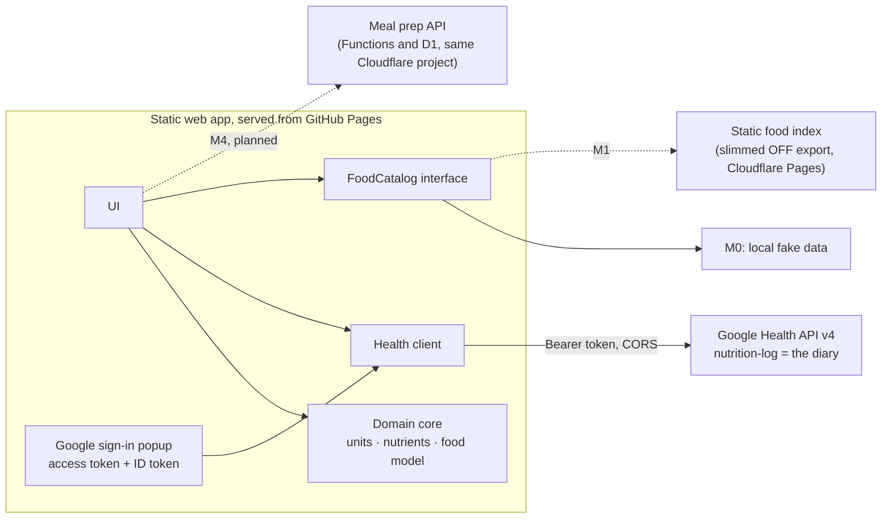

# Food Diary: architecture

Status: MVP = proof of concept (milestone M0), revised 1 November 2026.
Input: the research brief *Food Diary App — Research Brief* (claude.ai artifact R564ZbBksjMt7uTPWngVyq).

## 1. Goal and ground rules

The app is a food diary with a better logging UI than the Google Health app. **The diary is not stored
here**: it lives in the user's Google Health account (the successor of the Fitbit Web API), and
food definitions come from existing food databases. Meal prep adds one small database for what Google
Health cannot hold, and never copies the diary into it (section 4.5).

* **The Google Health API is the only integration.** The app reads and writes the user's nutrition log
  there and nowhere else. Syncing that log with other platforms is Google Health's job, not the app's.
* **No custom backend, apart from recorded exceptions.** Everything runs in the browser as a static site.
  Where that is not possible, the trade-off is written down in [DECISIONS.md](DECISIONS.md) instead of
  quietly adding a server. The one exception so far is the meal prep API (DR-24).
* **MVP = proof of concept:** sign in, write minimal entries, show the day. Food search,
  long-lived sessions and meals are post-MVP milestones (see [ROADMAP.md](ROADMAP.md)).

## 2. Verified facts

Sources: the API discovery document (`https://health.googleapis.com/$discovery/rest?version=v4`,
revision `20261030`), Google's documentation as indexed by search, and live HTTP probes on
1 November 2026.

| # | Finding | How verified |
|---|---------|--------------|
| V1 | `health.googleapis.com` allows CORS from any origin, with the `authorization` and `content-type` headers and all methods. **The browser can call the API directly.** | Preflight and GET from a foreign origin |
| V2 | **`googlehealth.nutrition.readonly` exists.** Google's authorisation server accepts it, and Google's scopes and nutrition pages list it for `nutrition-log`, `food` and `hydration-log`. The discovery document leaves it out of its method scope lists, which is a gap in that file only. | Authorisation request with a public client: the real scope goes to sign-in, a made-up `googlehealth.bogus.readonly` returns `invalid_scope` |
| V3 | With only `nutrition.writeonly`, reads are implicitly limited to `self-sources` (data this OAuth client wrote). With `readonly`, the default `all-sources` family returns the whole diary: the Google Health app, devices and other apps. | API docs (filters page, list method) |
| V4 | Every data point records its writer in `dataSource.application`: `packageName` for mobile apps, `googleWebClientId` for web clients. The app uses this to tell its own entries (which the write scope lets it delete) from everyone else's. | Discovery document |
| V5 | `dataPoints.create` takes a `DataPoint` whose `name` may carry a client-supplied ID (4–63 chars, `[a-z0-9-]`). It returns an `Operation` (`done`, `response`, `error`). | Discovery document |
| V6 | Day filter: `nutrition_log.interval.civil_start_time >= "YYYY-MM-DD" AND … < "YYYY-MM-DD"`. Results are newest first, paged by `nextPageToken`. | Discovery document |
| V7 | `NutritionLog` fields: `interval` (start/end time plus UTC offsets as durations, e.g. `"39600s"`), `foodDisplayName`, `mealType`, `energy.kcal`, `totalFat`, `totalCarbohydrate`, `nutrients[]` (39-value enum, grams), `serving` (a `food-measurement-unit` reference plus an amount), `food`. There is no free-form metadata field. | Discovery document |
| V8 | Google's token endpoint (`oauth2.googleapis.com/token`) allows CORS, but **refuses to exchange an authorisation code without `client_secret`, even with PKCE** (`invalid_request: client_secret is missing`). | Live POST from a foreign origin |
| V9 | In OAuth *Testing* status, refresh tokens expire after 7 days. In *Production* they last until revoked or unused for about six months. All Google Health scopes are *restricted*: an unverified app is capped at 100 users and needs a security assessment to go beyond that. | Google Health setup docs (via search); one unconfirmed report says unverified production apps also get 7-day tokens (spike B) |
| V10 | Webhooks: a *subscriber* (one HTTPS URL per Cloud project) is registered with the `cloud-platform` scope. Google checks it by POSTing twice: it must answer `201` with the shared secret and `401`/`403` without. The `AUTOMATIC` policy then notifies for every user who consented, so there is no per-user setup. The `Subscription` docs list only altitude, distance, floors, sleep, steps and weight; nutrition-log support is unconfirmed. | Discovery document |
| V11 | **One sign-in can return an access token and an ID token together.** `response_type=token id_token` with `openid` and both nutrition scopes returned both, each lasting 60 minutes, with a valid signature, audience and nonce. Google's token client never returns an ID token. `sub` and `healthUserId` are different values, so they cannot be compared. In desktop Chrome the popup kept its `window.opener` link and closed itself. | Real account in desktop Chrome, twice, 7 November 2026 |
| V12 | A nutrition log refers to its unit as `users/me/dataTypes/food-measurement-unit/dataPoints/<n>`, while the unit list names the same unit under the user's own ID (`users/<user ID>/…/<n>`). The user part must not be compared as written ([#74](https://github.com/Froussios/fitbit-nutrition-portal/pull/74)). | Owner's debug log from real use, 7 November 2026 |

## 3. Components



| Layer | Folder | Notes |
|---|---|---|
| Domain core | `src/core/` | Pure TypeScript, no I/O, unit-tested. The unit model, the nutrient model (each nutrient maps to an Open Food Facts key and to a Google Health slot), `FoodItem`, the Open Food Facts record normaliser, ID encoding and time helpers. |
| Google Health client | `src/health/` | Thin `fetch` wrapper typed from the discovery document. Maps a `LogDraft` to a `DataPoint` and a `DataPoint` to a `DiaryEntry`. |
| Food data | `src/food/` | `FoodCatalog` interface, implemented in M0 by `LocalFoodCatalog` over fake data (section 6). |
| Auth | `src/auth/`, `public/auth-callback.*` | Popup sign-in returning an access token and an ID token (section 5). |
| On-device AI | `src/ai/` | Chrome's built-in model, used only if the user ticks the setting. Its answers are checked by rules in `src/core/amount-answer.ts` (DR-26). |
| UI | `src/ui/`, `src/main.ts` | Plain TypeScript and DOM. Three screens; no framework yet. |

Hosting is the static build (`vite build`), deployed to GitHub Pages by `.github/workflows/ci.yml`.

## 4. Data model

### 4.1 Food and units

A `FoodItem` stores nutrients **per 100 g or per 100 ml** (its `basis`), plus named portions
(`"1 can" = 375 ml`) and an optional density.

* Any unit or portion converts freely within mass, or within volume. Household units are Australian
  metric: tsp 5 ml, tbsp 20 ml, cup 250 ml.
* Mass ↔ volume conversion happens **only** with an explicit density. Otherwise the UI offers no unit of
  the other kind. We never assume 1 ml = 1 g.
* A source's portion that is only a weight or volume of its stated size (`100 g`, `1 oz`, `1 oz, cooked`) is dropped when
  the food index and generic foods file are built (`core/portions.ts`), since a unit already offers it. Named servings (`1 pie (150 g)`) and measures of another size
  (`1 cup` = 125 g, `1 oz, dry, yields` 170 g) stay (DR-28).
* Amounts are typed as free text (`90 g`, `1 1/2 cups`, `2 × can`) and read by fixed rules in `core/amount-text.ts`. A bare
  number uses the unit already showing, and a unit is never decided after it was typed (DR-25).
  With the AI setting on, an on-device model can read what the rules refuse, such as a mistyped unit (DR-26).
* Displayed amounts and decimal measurements in serving/pack labels use at most one decimal place
  (`354.88199999999995mL` → `354.9mL`), with en-AU thousands separators
  (`1234.56 g` → `1,234.6 g`). Nonzero amounts below 0.1 retain three significant digits.
  This formatting applies in search, unit options, diary history and meal prep descriptions; original portion keys,
  calculation values and editable amounts keep their precision. In history names, a trailing ` (x g)` or
  ` (x ml)` amount suffix is rounded; the rest of the food name and fractions stay as supplied.
  Unrecognised attached units/text and punctuation stay as supplied (`0.3333333cup`, `354.882, iced`, `12.345%`).
* `fromOffProduct()` turns an Open Food Facts product record into a `FoodItem`. It handles `_100g` values
  that really mean per 100 ml (legacy liquids), per-serving-only data (typical for restaurant items) and
  kJ-only energy. The fake catalogue is written as Open Food Facts records and runs through this
  normaliser, so the future mirror changes the data, not the model.

### 4.2 Diary entry → `nutrition-log`

| Draft | `NutritionLog` field |
|---|---|
| time eaten | `interval.startTime` (+1 min for `endTime`), local offset in `startUtcOffset` / `endUtcOffset` |
| meal | `mealType` (`BREAKFAST`, `LUNCH`, `DINNER`, `SNACK`), left out when the user picks no meal, which is the default. The legacy `ANYTIME` is never written. |
| food name | `foodDisplayName`, e.g. `Rolled oats` or `Cola soft drink (Sample Drinks Co)` |
| amount | `serving` = the API's *gram* or *millilitre* `food-measurement-unit` plus an amount, keeping the kind of unit the user chose (250 g of milk stays 250 g). If the API's units cannot be resolved, the amount goes into the name instead (`Rolled oats (40 g)`). |
| energy | `energy.kcal` (`userProvidedUnit: KILOCALORIE`). The UI shows either kcal or kJ, as chosen in the page header (DR-21). |
| fat, carbohydrate | `totalFat`, `totalCarbohydrate` (top-level fields) |
| other nutrients | `nutrients[]`: protein, sugars, fibre, saturated, trans, mono- and poly-unsaturated fat, cholesterol, sodium, potassium, calcium, iron, caffeine, vitamin C |

Entries are **anonymous** logs: they supply their own name and nutrients, because our foods are not
Google `food` resources. Anonymous logs cannot be updated, so an edit writes a corrected copy and deletes the original (DR-22).

### 4.3 Client-supplied IDs carry the food reference

`NutritionLog` has nowhere to store which food an entry came from, so the data point ID carries it:

```
e-<logged-at base36>-<random4>-<source>[-<food id>]     e.g. e-mvxb00vd-9gcl-smp-oats
```

`source` is `off`, `afcd`, `aus` (AUSNUT), `fnds` (USDA FNDDS), `usda`, `smp` (sample), `man` (manual), `prep` (a meal prep
portion, section 4.5) or `meal` (a saved meal, section 4.6), so usage per database can be counted from the diary. The food ID is dropped when it does not
fit in 63 characters or is not ID-safe. Editing an entry uses this reference to load the food again, for its exact values
and its portions, and the copy that replaces the entry keeps the same source and food (DR-22).

### 4.4 Reading the diary

The diary list reads **all sources** (with `nutrition.readonly`), so its totals match the Google Health
app. Each row shows its amount (from `serving`). Edit and delete buttons appear only on this app's entries, because
the write scope covers only data the app added. Other apps' entries show a lock instead, with a note naming
the app that logged them (the Google Health app or another app's package name), or saying another app did if the
writer is unknown. Deleting asks nothing: the row stays crossed out and out of the totals, with an
Undo that logs an equivalent entry under a new ID (DR-20). If a delete or undo fails, the row is enabled again and
an alert says so until it is dismissed or the action is tried again. Editing changes an entry's amount and meal in its
own row, which replaces the entry with a corrected copy under a new ID (DR-22). It shows one day, today unless the
arrows beside its heading step to another (#19); there is no step past today. A calendar icon
button opens the browser's own date picker (`showPicker()` on a hidden date field, `max` today), and a Today button jumps back. The day is
in the page URL as `?day=YYYY-MM-DD`, a query parameter because GitHub Pages has no fallback for unknown paths. The URL is
replaced, not pushed, so stepping adds no browser history. Today, a later day or a non-date in it shows today, and it is
taken out. The form logs on the day shown, at the
current clock time unless a time is picked, and polling refreshes that day. If the user unticks the read permission on Google's consent screen, the
app falls back to its own entries and says so.

Food search also reads the newest 300 of this app's own entries (`self-sources`), once per page load in the
background, to favour foods logged before ([FOOD_SEARCH.md](FOOD_SEARCH.md#14-foods-logged-before)).

### 4.5 Meal prep

[#55](https://github.com/Froussios/fitbit-nutrition-portal/issues/55), DR-24. The user records a recipe when cooking, then logs fractions of it (`1/6`, `25%`) until it is finished or
discarded. Fractions are of the whole batch. Weights are not offered, because the ingredients do not add up to the cooked weight.

**The database adds to the diary and does not mirror it.** A portion is one ordinary diary entry with summed nutrients,
named `Chili (1/6)`, with the ID `e-<time>-<rand>-prep-<prepId>`. Google Health stays the only record of what was eaten.

```sql
preps(user_id, id, name, ingredients, created_at, updated_at, discarded_at)        -- PRIMARY KEY (user_id, id); ingredients is JSON
portions(user_id, id, prep_id, fraction, entry_id, state, eaten_at, created_at)    -- PRIMARY KEY (user_id, id); migrations/0001_meal_prep.sql
```

* **Screens.** The card above the diary has three tabs (`src/ui/entry-card.ts`): Log food, Meal prep and Saved meals (section 4.6). In **Log food**, the food search also
  finds meal preps, and the preps on hand are offered under the empty search (FOOD_SEARCH.md section 3.1). A chosen
  prep shows what is left of the batch and asks for a share of it, with the meal and time as for any food, and has
  Eat the rest and Discard batch. The **Meal prep** tab (`src/ui/prep-card.ts`) lists each prep on one line with what
  is left. Its Log a portion opens Log food with the prep chosen. It also has Edit, Discard, New prep, and a list of what
  was eaten, where a portion can be removed. A portion's row in the diary can be deleted and undone, but not edited, because
  its fraction lives in the prep. The builder (`src/ui/prep-builder.ts`, shared with saved meals) lists the ingredients, whose amounts can be
  changed in place (`src/ui/ingredient-list.ts`), and finds each new one in the food catalogue
  (`src/ui/ingredient-adder.ts`); custom foods can't be ingredients yet. The tab is hidden on a site without the API, and the search then finds
  foods only. The app checks for the API with a request that carries no token: a request with one needs a CORS
  preflight, which a site without the API refuses, so its 404 would look like a network failure.
* **Ingredients** keep the nutrients worked out when cooking, because custom foods cannot be reloaded and the weekly
  index can change. Editing them affects later portions only: a portion already in the diary keeps its nutrients.
* **Identity.** The Google access token never goes to our API, because it can read and write the diary. It receives a Google
  **ID token** instead, which proves who the user is and grants no API access. The API checks its signature against Google's
  public keys, and its `aud` (this app's client ID), `iss` and `exp`. `user_id` is its `sub`, which is stable and never reused.
  The `sub` alone would not do: anyone who knew it could use it. The user ID never comes from the request, and the API ignores
  the token's email and name and does not store the token. No `nonce` reaches the API, so a stolen ID token can be replayed
  until it expires. That reaches meal prep data only, not the diary.
* **One sign-in.** One request to Google returns both tokens (V11), so they are always for the same account, and **Continue**
  renews both. The app opens its own popup, and a callback page with no other scripts passes the answer back through
  `window.opener` (section 5.1). It never uses a `BroadcastChannel`, because `froussios.github.io` is shared with other Pages
  sites. If a renewal
  returns a different `sub`, the user switched account, so the app drops the meal prep state it holds for the previous one.
* **Eating a portion.** An atomic `INSERT … SELECT … WHERE` reserves the portion only if the total stays at or under 100%,
  so two devices cannot overrun it. The app then writes the diary entry, then marks the portion confirmed. If Google
  rejects the entry, the portion is removed. If the answer is lost or the browser closes first, the portion counts as eaten
  and stays unconfirmed. A portion is logged at the time chosen in the form, which is on the day the diary shows, as for any
  food. Each refresh of a day's diary confirms the unconfirmed portions its listing shows. An unconfirmed portion is never released automatically, because its entry may exist; the prep shows
  it, and the user can give it back.
* **Removing a portion.** Deleting one in the diary gives it back, and Undo is refused if it would pass 100%. The app finds
  the portion by its entry ID, or else by its name and the time it was eaten, to within a second, because Google may store an entry under
  its own ID and not say so. It does not rely on the ID's `prep` source. The diary shows
  one day at a time, so the prep also lists its portions, each with a remove button. Deletes made in the Google Health app
  are not detected; removing the portion from the prep corrects the amount left.
* **Editing a portion in the diary.** Only its meal may change, because a new fraction would have to go through the
  reservation above. Today the editor offers any entry's amount, as "× this entry" when it has no g or ml and its food is
  not found (DR-22), so meal prep must turn the amount off for `prep` entries. An edit gives the entry a new ID, so `portions.entry_id` must move to it, or the portion loses
  track of its entry. The delete inside an edit must not give the portion back: only a delete by the user does.
* **Finished and discarded preps** are hidden and kept for 30 days, so that an undo can bring them back, then deleted the
  next time that user's list loads. An unfinished recipe draft stays on the device until it is saved.
* **Failures.** If the API is down, eating is blocked and normal logging still works, as with other failures (DR-18).
* **API.** `functions/api/[[path]].ts` hands every request to `server/handler.ts`:

  | Request | Does |
  |---|---|
  | `GET /api/preps` | The user's preps and their portions, after deleting those ended over 30 days ago |
  | `PUT /api/preps/:id` | Creates a prep, or replaces its name and ingredients |
  | `PATCH /api/preps/:id` | `{ discarded }`: discards a prep or brings it back |
  | `POST /api/preps/:id/portions` | Reserves `{ id, fraction, entryId, eatenAt }`, or the rest when `fraction` is null; 409 with `left` if too much |
  | `PATCH /api/portions/:id` | `{ entryId }`: the diary entry exists |
  | `DELETE /api/portions/:id` | Gives a portion back |

  The client chooses prep and portion IDs, so a request whose answer is lost can be sent again: reserving the same portion ID
  twice returns the first reservation. Only the app's origins get CORS headers, answers are never cached, and errors never
  echo request data. `src/core/prep.ts` holds the shapes and checks that the browser and API share.
* **Deployment.** The Functions live at `/api/*` in the `food-diary-index` Pages project, and `_routes.json` (written by the
  index build) keeps every other request static, so food search does not use the Functions allowance. A Pages deploy replaces
  the whole site, so API changes ship only through the Food index workflow. It creates the database if needed, applies
  `migrations/` first with `CLOUDFLARE_D1_TOKEN`, then deploys with the Pages token, since attaching a database needs no
  D1 permission. Without that secret, or if it can't reach D1, it warns and leaves the API out, still publishing the
  index. If preparing or deploying the API fails anyway, it publishes the index without it and fails the run (README,
  Food index).

### 4.6 Saved meals

DR-29. A saved meal is a name and its ingredients, kept in the same database and API as meal prep (section 4.5), and
logged as one entry under its name. It has nothing left to track: each log is one serving.

```sql
meals(user_id, id, name, ingredients, created_at, updated_at)   -- PRIMARY KEY (user_id, id); ingredients is JSON; migrations/0002_saved_meals.sql
```

* **Screens.** The **Saved meals** tab (`src/ui/meal-card.ts`) lists the meals by name with their energy. Each one's
  ingredients and amounts open under it ("3 ingredients"). It has Log,
  Edit, Delete (with an undo until reload, which saves the meal again) and New meal, which open the builder of
  section 4.5. In **Log food** the search finds saved meals, and up to 8 are offered under the empty search. A chosen
  meal shows its ingredients: an amount can be changed in the unit it was added in, an ingredient left out or put
  back, and another added, for this entry only. "Reset to the saved meal" undoes that, and so does logging, so each
  entry starts from the meal as saved.
* **Logging** writes one entry like a meal prep portion: the meal's name, the summed nutrients, no `serving`, and the
  ID `e-<time>-<rand>-meal-<mealId>`. The database is not written. The entry can be edited ("× this entry", DR-22) and
  deleted like any other the app wrote. Ingredients come from `catalog` foods, which never include a meal or a prep.
* **A meal in a meal.** The builder's search, and the one under a chosen meal in Log food, also find saved meals. One
  is added as copies of its ingredients, scaled to the servings typed (`expandMeal` in `src/core/meal.ts`), so there is
  no nesting to resolve and later edits to it change nothing here. A meal holds at most 60 ingredients, as a prep does.
* **Ingredients** keep the nutrients worked out when added (section 4.5), and a new amount scales them. Editing a saved
  meal changes later entries only.
* **Older API.** An API without `/api/meals` answers its own 404, and the app hides saved meals but keeps meal prep.
  The app deploys on merge, but the API only with the Food index workflow, so for a while the app may run against it.
* **API.**

  | Request | Does |
  |---|---|
  | `GET /api/meals` | The user's saved meals |
  | `PUT /api/meals/:id` | Creates a meal, or replaces its name and ingredients |
  | `DELETE /api/meals/:id` | Deletes a meal; deleting one that is gone succeeds |

## 5. Authentication

### 5.1 Current: a popup returning two tokens

One request to Google (`response_type=token id_token`) returns an access token and an ID token, each lasting
about an hour (V11). The app asks directly because Google's token client never returns an ID token, although Google
recommends its library for this flow (DR-24). Google answers on `auth-callback.html`, a page with no other scripts, which
removes the tokens from its URL and passes them to the window that opened it. The app accepts the answer only from that
window on its own origin with the right `state`, and checks the ID token's `aud`, `iss`, `exp` and `nonce`. It keeps the
tokens in `sessionStorage`. The access token is only ever sent to Google, and the ID token only to our own API.

When they expire the user clicks **Continue**. The app passes the account's `sub` as `login_hint`, kept in `localStorage`
until the user signs out, so that Google should not ask which account to use. Consent is remembered. After sign-in the app
calls `users.getIdentity` to detect `ACCOUNT_NOT_LINKED`. The diary loads without waiting for the answer, because each
request to the Health API takes a second or more, and a new URL costs a CORS preflight that takes as long again. Signing
out revokes the access token, as best it can, because Google documents no CORS support for revoking.

### 5.2 Long-lived sessions: deferred to milestone 3

Long-lived sessions are strongly preferred but are punted to milestone 3. These are the findings to start
from.

Long-lived access needs a **refresh token**. Google issues those only from the authorisation-code flow,
and for a *Web application* client the code exchange needs the **client secret** (V8). PKCE does not
replace the secret for this client type. This is deliberate: Google treats a browser as a *public client*
that cannot keep a secret, and does not give it refresh tokens that would sit in script-readable storage.
Two more constraints apply to every option:

* While the OAuth app is in **Testing** status, refresh tokens die after 7 days (V9). Long-lived login
  also requires moving the app to **In production**. Unverified, that means a 100-user cap and an
  "unverified app" warning. Verified, it means a security assessment.
* A silent refresh in the background (no click) is not possible with the popup: it needs a user gesture.

| Option | Long-lived? | What it costs |
|---|---|---|
| A0. Status quo (popup) | No, hourly click | Nothing |
| A1. Client secret shipped in the static app (code + PKCE from the browser; the token endpoint allows CORS) | Yes, in Production status | Breaks Google's rule that web-client secrets stay confidential. Anyone can copy the secret and pose as the app's client. Refresh tokens sit in browser storage. Would fail the security assessment needed above 100 users. |
| A2. Stateless token broker: one serverless function with `/token` (code → tokens) and `/refresh`. It holds the secret and stores nothing; the refresh token stays with the browser (an encrypted HttpOnly cookie is safest). | Yes, in Production status | A deployed function, so a small exception to "no backend", but with no database and no user data at rest. |

Current leaning: A2 plus Production status ([decision D1](https://github.com/Froussios/fitbit-nutrition-portal/issues/22)). The auth layer (`src/auth/`) is the only code this decision
touches: the Health client asks a token provider for a token and does not care how it was obtained.

### 5.3 Why a Google Cloud project is needed

Every Google OAuth client belongs to a Cloud project. The project is how Google identifies the app on the
consent screen, which APIs it may call (the Google Health API must be enabled), its quotas, its
verification status and the origins it may run on. Creating one is free.

* **One project for the app**, owned by the developer. **End users never create one**: they sign in with
  their normal Google account. The client ID is public and baked into the build; the "Developer setup"
  screen only appears in a build without one.
* There is no other way to reach Google Health data in the cloud. The legacy Fitbit Web API, which had its
  own app registration, is switched off on **2 November 2026**.
* Use two projects (development and production): the API has no sandbox.

## 6. Food data

The app **never queries the public Open Food Facts API**. Its read limits (about 15 products and
10 searches per minute per IP) cannot support interactive search. All food access goes through
`FoodCatalog` (`search`, `get`):

* **M0:** `LocalFoodCatalog` over a handful of fake records written in the Open Food Facts format.
* **M1:** search-as-you-type over Open Food Facts using exact words in any order, ranked generic products first, then by how much of
  the product name the query covers (DR-13, DR-15). A weekly GitHub Action slims the Open Food Facts export
  of the whole world dataset (dead rows and unused fields dropped), sorts products in ranking order and
  publishes a sharded word index as static files on Cloudflare Pages (never in git), served at
  `food-index.froussios.com`. The browser runs the search itself but
  fetches only the index files each query needs, never the whole index (data use: FOOD_SEARCH.md section 9.1). ODbL allows this, with
  attribution and share-alike on the database. No server and no monthly cost (DR-14). Generic
  foods come from authoritative sources, AFCD and USDA FNDDS, in a small file searched in the browser (DR-16). Full design: [FOOD_SEARCH.md](FOOD_SEARCH.md).

## 7. Decisions, milestones and spikes

These are maintained separately, so they stay in sync with the GitHub issues:

* [DECISIONS.md](DECISIONS.md): recorded decisions (DR-01…) and open ones (D1 long-lived sessions).
  D2 (live updates) is decided as polling: DR-08; D3 (food data mirror) as DR-14.
* [ROADMAP.md](ROADMAP.md): the MVP (M0) and its targets, post-MVP milestones M1–M4 with their issues, spikes, and
  work saved for later.
