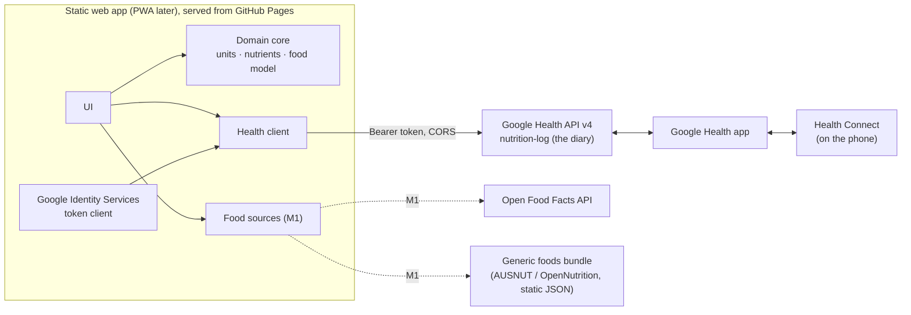

# Food Diary: architecture

Status: proof of concept (milestone 0), 1 November 2026.
Input: the research brief *Food Diary App — Research Brief* (claude.ai artifact R564ZbBksjMt7uTPWngVyq).

## 1. Goal and ground rules

The app is a food diary with a better logging UI than the Google Health app. It keeps **no database of
its own**: the diary lives in the user's Google Health account (the successor of the Fitbit Web API), and
food definitions come from existing food databases.

On top of the brief we add one rule: **no custom backend**. Everything runs in the browser as a static
site. Where that is not possible, the trade-off is listed in [section 6](#6-compromises-for-discussion) for a
decision rather than quietly adding a server.

## 2. What was verified for this design

These facts come from the live API on 1 November 2026: the discovery document
(`https://health.googleapis.com/$discovery/rest?version=v4`, revision `20261030`) and direct HTTP checks.
Some of them change the brief.

| # | Finding | Effect |
|---|---------|--------|
| V1 | `health.googleapis.com` answers CORS preflights for any origin (`Access-Control-Allow-Origin` echoes the origin; allows `authorization, content-type` and all methods). | **Brief spike 4 is resolved: the browser can call the API directly.** No proxy is needed. |
| V2 | The only nutrition scope published is `googlehealth.nutrition.writeonly`. There is **no `nutrition.readonly`** in the discovery document. (The brief lists one; it is either unpublished or a mistake.) | See V3. |
| V3 | The API docs say: callers with only write scopes for a data type "may only read the data they wrote themselves", meaning their queries are implicitly limited to `self-sources`. | **The app can read back only the entries it wrote.** Entries made in the Google Health app or synced from Health Connect are invisible. See [C1](#c1-the-app-cannot-read-the-full-diary). |
| V4 | Filtering by data source family is not supported for `food` and `food-measurement-unit`. When the restriction is only implied by write-only scopes, the call fails with `PERMISSION_DENIED`. | We probably cannot list Google's foods or measurement units. **All logs are "anonymous"** (our own name and nutrients), and `serving` is usually omitted. The PoC tries the unit list and falls back without error. |
| V5 | `dataPoints.create` takes a `DataPoint` whose `name` may carry a client-supplied ID (4–63 chars, `[a-z0-9-]`). It returns an `Operation` (`done`, `response`, `error`). | Idempotent writes and IDs that carry meaning (section 4.3). |
| V6 | List filter for a day: `nutrition_log.interval.civil_start_time >= "YYYY-MM-DD" AND nutrition_log.interval.civil_start_time < "YYYY-MM-DD"`. Results are newest first, paged by `nextPageToken`. | Used for the "Today" table. |
| V7 | `NutritionLog` has `interval` (start/end time plus UTC offsets as durations, e.g. `"39600s"`), `foodDisplayName`, `mealType`, `energy.kcal`, `totalFat`, `totalCarbohydrate`, `nutrients[]` (39-value enum, grams), `serving`, `food`. There is no metadata field. | Mapping in section 4.2. |

Not verified here (blocked from this environment, or needs a real account): Open Food Facts CORS and
write API, the webhook payload, and anything about Health Connect sync. These stay open as spikes.

## 3. Components



| Layer | Folder | Notes |
|---|---|---|
| Domain core | `src/core/` | Pure TypeScript with no I/O, unit-tested. The unit model, the nutrient model (each nutrient maps to an Open Food Facts key and to a Google Health slot), the `FoodItem` model, the Open Food Facts normaliser, ID encoding and time helpers. |
| Google Health client | `src/health/` | Thin `fetch` wrapper typed from the discovery document. Maps a `LogDraft` to a `DataPoint` and back to a `DiaryEntry`. |
| Auth | `src/auth/` | Google Identity Services token model (section 5). |
| Food data | `src/data/` | M0: a sample catalogue written as Open Food Facts records. M1: live Open Food Facts search and a bundled generic-food dataset. |
| UI | `src/ui/`, `src/main.ts` | Plain TypeScript and DOM. The PoC has three screens (setup, sign in, diary), so it uses no framework. Revisit at M2 when screens multiply. |

Hosting is a static build (`vite build`). The workflow in `.github/workflows/ci.yml` deploys it to GitHub
Pages. The OAuth client ID is public and either baked in at build time or typed in on the setup screen.

## 4. Data model

### 4.1 Food and units (milestone-proof)

A `FoodItem` stores nutrients **per 100 g or per 100 ml** (its `basis`), plus named portions
(`"1 can" = 375 ml`) and an optional density. This is the unit model the brief recommends:

* Within mass, or within volume, any unit or portion converts freely. Household units are Australian
  metric: tsp 5 ml, tbsp 20 ml, cup 250 ml.
* Mass ↔ volume conversion happens **only** with an explicit density. Without one the UI offers no unit
  of the other kind. We never assume 1 ml = 1 g.
* `fromOffProduct()` turns an Open Food Facts product into a `FoodItem`. It handles `_100g` values that
  really mean per 100 ml (legacy liquids), per-serving-only data (typical for restaurant items) and kJ-only
  energy. The PoC's sample foods are fed through this same normaliser, so M1 swaps the data source, not the
  model.

### 4.2 Diary entry → `nutrition-log`

| `FoodItem` / draft | `NutritionLog` field |
|---|---|
| time eaten | `interval.startTime` (+1 min for `endTime`), local offset in `startUtcOffset` / `endUtcOffset` |
| meal | `mealType` (`BREAKFAST`, `LUNCH`, `DINNER`, `SNACK`, `ANYTIME`) |
| name and amount | `foodDisplayName` = `"<name> (<brand>) (<amount>)"`, e.g. `Rolled oats (40 g)`. The amount sits in the name because Health Connect's `NutritionRecord` has no serving field. |
| energy | `energy.kcal` with `userProvidedUnit: KILOCALORIE`. The UI shows both kcal and kJ. |
| fat, carbohydrate | `totalFat`, `totalCarbohydrate` (top-level fields, not `nutrients[]`) |
| everything else | `nutrients[]`: protein, sugars, fibre, saturated, trans, mono- and poly-unsaturated fat, cholesterol, sodium, potassium, calcium, iron, caffeine, vitamin C |
| amount in base unit | `serving` (only if the API lets us resolve the gram or ml unit, see V4) |

Every entry is an **anonymous** log: it supplies its own name and nutrients. Anonymous logs cannot be
updated, so an edit means delete and recreate (planned for M3).

### 4.3 Client-supplied IDs carry the food reference

`NutritionLog` has nowhere to store "which food was this". The data point ID does instead:

```
e-<logged-at base36>-<random4>-<source>[-<food id>]     e.g. e-mvxb00vd-9gcl-off-9300633000001
m-<meal id>-<n>-...                                     meal ingredients (M2, per the brief)
```

`source` is `off`, `aus`, `usda`, `smp` (sample) or `man` (manual). The food ID is dropped when it does not
fit in 63 characters or is not ID-safe. This makes "log again", the meal library and corrections possible
without a database: they are rebuilt from our own diary history (which V3 still lets us read).

## 5. Authentication without a backend

* **Google Identity Services, token model.** A popup returns a short-lived access token (about 1 hour).
  There is no client secret and no refresh token, because the authorisation-code flow for a web client
  needs a secret, and a secret needs a server.
* The token is kept in `sessionStorage`, so it survives a reload but not closing the tab. When it expires
  the UI shows **Continue**. The popup usually closes by itself because consent is remembered. This also
  avoids the brief's "refresh tokens expire after 7 days in Testing mode" problem: there are no refresh
  tokens.
* After sign-in the app calls `users.getIdentity` to detect `ACCOUNT_NOT_LINKED` (the user never opened the
  Google Health app) and tells the user what to do.
* Google classes every Google Health scope as restricted: up to 100 test users while unverified, and a
  security assessment beyond that.

## 6. Compromises for discussion

Each item gives what a client-only app cannot do, the options and a recommendation. The ones marked
**decision** need your call.

### C1. The app cannot read the full diary

*Not a backend problem:* a server would hold the same scopes. With only `nutrition.writeonly`, our list
shows only entries this app wrote. Daily totals miss anything logged in the Google Health app, by a
watch or meal app, or through Health Connect. That conflicts with the brief's "other apps' nutrition
appears through all-sources".

Options:

1. **Accept for now** (PoC behaviour, with a notice under the table). The app is the place you log; the
   Google Health app is the place you see the complete day.
2. **Probe for an unpublished read scope.** The setup screen's *Advanced → Extra OAuth scopes* field exists
   for this: try `https://www.googleapis.com/auth/googlehealth.nutrition.readonly`. If Google rejects it,
   sign-in fails with `invalid_scope`; clear the field to recover.
3. **Read Health Connect from an Android companion.** This does not help the web client.
4. **Watch the release notes.** Google plans more parity in Q4 2026 and Q1 2027.

Recommendation: 1 + 2 now, and re-check at every milestone. **Decision:** is "our entries only" acceptable
for the daily totals in M1–M2?

### C2. Live push needs a public endpoint

Google Health webhooks deliver to an HTTPS endpoint registered at project level (`projects.subscribers`,
which needs project credentials). A static site cannot receive them. FCM topic fan-out, as the brief
proposes, also needs a server to publish.

Client-only alternative, used by the PoC: **refetch on tab focus, plus every 5 minutes while the tab is
visible.** Each refetch is one list call per day viewed, far below the 300 requests/min/user limit. Two
open browser tabs or devices converge within 5 minutes, or at once on focus.

Recommendation: poll. Add the stateless webhook relay only if cross-device latency becomes a real
complaint. **Decision:** is "updates on focus or within 5 minutes" good enough?

### C3. Sessions last about an hour

Without a server-held client secret there are no refresh tokens, so the user clicks **Continue** about
once an hour of active use. A tiny stateless token-exchange function could hold the secret and return
refresh tokens to the browser (cookie or memory) without storing anything, but it is still a backend.

Recommendation: accept for M0–M2, and revisit with the PWA in M3.

### C4. Food search sources

| Source | Client-side? | Notes |
|---|---|---|
| Open Food Facts read/search | Yes (keyless; CORS to be confirmed in M1) | Rate limits are per IP (about 10 searches/min), so calling from each user's browser spreads the load better than a shared proxy would. The UI must search on submit or debounce, not on every keystroke (OFF asks for this), and cache results in IndexedDB. |
| Generic foods (AUSNUT / OpenNutrition) | Yes | Ship a pre-processed subset as a lazy-loaded static JSON chunk and search it locally. Check the licence (FSANZ terms; OpenNutrition licence). |
| USDA FDC | Possible | Needs an api.data.gov key, which would be visible in the browser. Low value for Australia; skip. |
| FatSecret / Nutritionix (commercial) | **No** | Needs a server-held secret. Only if spike 7 shows the open sources are too thin. |

Recommendation: Open Food Facts plus a bundled generic dataset, client-only. A commercial source is the
first thing that would force a backend.

### C5. Contributing to Open Food Facts

Writing a product needs Open Food Facts credentials. With the **user's own Open Food Facts account**
(signed in from the app) this stays client-side and attributes edits to the person. A shared app account
would need a secret, so a backend. Recommendation: the user's own account (to verify in M1).

### C6. No serving or food IDs in the API (V4)

Because `food` and `food-measurement-unit` cannot be listed with write-only scopes, every log is
anonymous and usually has no `serving`. Our own records keep the amount (in the display name, and
recoverably via the ID and food source). Cost: the Google Health app shows our entries as plain named
items, and they cannot be edited in place.

### C7. Custom meals

These work client-side as the brief proposes: one entry per ingredient with grouped IDs
`m-<meal>-<n>`, and the meal library rebuilt from our own history (readable despite V3). A meal exists
only after it has been logged once. **Decision** (open question in the brief): is that acceptable for v1?

## 7. Milestones

| Milestone | Scope | Backend? |
|---|---|---|
| **M0: PoC (this)** | Sign in, log an entry from sample foods (OFF-shaped) or a custom food, today's table with totals, delete. | No |
| M1: food search | Open Food Facts search and barcode lookup, bundled generic foods, recent-foods cache (IndexedDB), confirm OFF CORS and limits. | No |
| M2: meals | Meal builder from known ingredients, `m-` grouped IDs, "log again", history cache. | No |
| M3: daily driver | Installable PWA, offline write queue, edit (delete and recreate), day navigation, kJ/kcal preference. | No (revisit C2/C3) |
| M4: Health Connect | Brief spike 1 (do API logs reach Health Connect?) and decide on an Android companion. | No server; maybe an app |

## 8. Spike status

| Brief spike | Status |
|---|---|
| 1. API → Health Connect | Open; needs a phone. |
| 2. What `food` list returns | Likely moot: with write-only scopes the call is refused (V4). Confirm with a real account. |
| 3. Webhook latency and payload | Deferred (C2). |
| 4. Browser access / CORS | **Done: allowed (V1).** |
| 5. Reusing a deleted ID | Open; the PoC's delete button makes it easy to test. |
| 6. Nutrient coverage vs Health Connect | Partly: our nutrient list maps 1:1 onto the API enum; Health Connect side open. |
| 7–8. Food coverage, FatSecret quote | M1. |
| New: read scope | Probe `nutrition.readonly` via Extra scopes (C1). |
