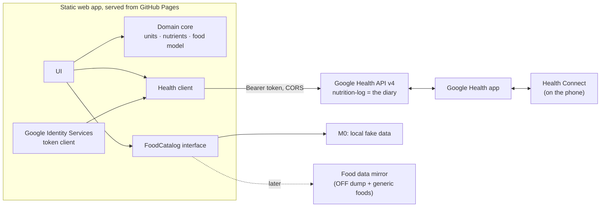

# Food Diary: architecture

Status: proof of concept (milestone 0), revised 1 November 2026.
Input: the research brief *Food Diary App — Research Brief* (claude.ai artifact R564ZbBksjMt7uTPWngVyq).

## 1. Goal and ground rules

The app is a food diary with a better logging UI than the Google Health app. It keeps **no database of
its own**: the diary lives in the user's Google Health account (the successor of the Fitbit Web API), and
food definitions come from existing food databases.

**No custom backend.** Everything runs in the browser as a static site. Where that is not possible, the
trade-off is written down in [section 7](#7-open-decisions) instead of quietly adding a server.

**Proof-of-concept scope:** sign in, log simple entries, show today's diary. Meals, food search and
offline use are out of scope.

## 2. Verified facts

Sources: the API discovery document (`https://health.googleapis.com/$discovery/rest?version=v4`,
revision `20261030`), Google's documentation as indexed by search, and live HTTP probes on
1 November 2026.

| # | Finding | How verified |
|---|---------|--------------|
| V1 | `health.googleapis.com` allows CORS from any origin, with the `authorization` and `content-type` headers and all methods. **The browser can call the API directly** (brief spike 4: done). | Preflight and GET from a foreign origin |
| V2 | **`googlehealth.nutrition.readonly` exists.** Google's authorisation server accepts it, and Google's scopes and nutrition pages list it for `nutrition-log`, `food` and `hydration-log`. The discovery document leaves it out of its method scope lists, which is a gap in that file only. | Authorisation request with a public client: the real scope goes to sign-in, a made-up `googlehealth.bogus.readonly` returns `invalid_scope` |
| V3 | With only `nutrition.writeonly`, reads are implicitly limited to `self-sources` (data this OAuth client wrote). With `readonly`, the default `all-sources` family covers the Google Health app, Fitbit devices, Health Connect and other API clients. | API docs (filters page, list method) |
| V4 | Every data point records its writer in `dataSource.application`: `packageName` for mobile apps, `googleWebClientId` for web clients. The app uses this to tell its own entries (which the write scope lets it delete) from everyone else's. | Discovery document |
| V5 | `dataPoints.create` takes a `DataPoint` whose `name` may carry a client-supplied ID (4–63 chars, `[a-z0-9-]`). It returns an `Operation` (`done`, `response`, `error`). | Discovery document |
| V6 | Day filter: `nutrition_log.interval.civil_start_time >= "YYYY-MM-DD" AND … < "YYYY-MM-DD"`. Results are newest first, paged by `nextPageToken`. | Discovery document |
| V7 | `NutritionLog` fields: `interval` (start/end time plus UTC offsets as durations, e.g. `"39600s"`), `foodDisplayName`, `mealType`, `energy.kcal`, `totalFat`, `totalCarbohydrate`, `nutrients[]` (39-value enum, grams), `serving`, `food`. There is no free-form metadata field. | Discovery document |
| V8 | Google's token endpoint (`oauth2.googleapis.com/token`) allows CORS, but **refuses to exchange an authorisation code without `client_secret`, even with PKCE** (`invalid_request: client_secret is missing`). | Live POST from a foreign origin |
| V9 | In OAuth *Testing* status, refresh tokens expire after 7 days. In *Production* they last until revoked or unused for about six months. All Google Health scopes are *restricted*: an unverified app is capped at 100 users and needs a security assessment to go beyond that. | Google Health setup docs (via search); one unconfirmed report says unverified production apps also get 7-day tokens (spike B) |
| V10 | Webhooks: a *subscriber* (one HTTPS URL per Cloud project) is registered with the `cloud-platform` scope. Google checks it by POSTing twice: it must answer `201` with the shared secret and `401`/`403` without. The `AUTOMATIC` policy then notifies for every user who consented, so there is no per-user setup. The `Subscription` docs list only altitude, distance, floors, sleep, steps and weight; nutrition-log support is unconfirmed. | Discovery document |

## 3. Components



| Layer | Folder | Notes |
|---|---|---|
| Domain core | `src/core/` | Pure TypeScript, no I/O, unit-tested. The unit model, the nutrient model (each nutrient maps to an Open Food Facts key and to a Google Health slot), `FoodItem`, the Open Food Facts record normaliser, ID encoding and time helpers. |
| Google Health client | `src/health/` | Thin `fetch` wrapper typed from the discovery document. Maps a `LogDraft` to a `DataPoint` and a `DataPoint` to a `DiaryEntry`. |
| Food data | `src/food/` | `FoodCatalog` interface, implemented in M0 by `LocalFoodCatalog` over fake data (section 6). |
| Auth | `src/auth/` | Google Identity Services token model (section 5). |
| UI | `src/ui/`, `src/main.ts` | Plain TypeScript and DOM. Three screens; no framework yet. |

Hosting is the static build (`vite build`), deployed to GitHub Pages by `.github/workflows/ci.yml`.

## 4. Data model

### 4.1 Food and units

A `FoodItem` stores nutrients **per 100 g or per 100 ml** (its `basis`), plus named portions
(`"1 can" = 375 ml`) and an optional density.

* Any unit or portion converts freely within mass, or within volume. Household units are Australian
  metric: tsp 5 ml, tbsp 20 ml, cup 250 ml.
* Mass ↔ volume conversion happens **only** with an explicit density. Otherwise the UI offers no unit of
  the other kind. We never assume 1 ml = 1 g.
* `fromOffProduct()` turns an Open Food Facts product record into a `FoodItem`. It handles `_100g` values
  that really mean per 100 ml (legacy liquids), per-serving-only data (typical for restaurant items) and
  kJ-only energy. The fake catalogue is written as Open Food Facts records and runs through this
  normaliser, so the future mirror changes the data, not the model.

### 4.2 Diary entry → `nutrition-log`

| Draft | `NutritionLog` field |
|---|---|
| time eaten | `interval.startTime` (+1 min for `endTime`), local offset in `startUtcOffset` / `endUtcOffset` |
| meal | `mealType` (`BREAKFAST`, `LUNCH`, `DINNER`, `SNACK`, `ANYTIME`) |
| name and amount | `foodDisplayName`, e.g. `Rolled oats (40 g)`. The amount is in the name because Health Connect's `NutritionRecord` has no serving field. |
| energy | `energy.kcal` (`userProvidedUnit: KILOCALORIE`). The UI shows both kcal and kJ. |
| fat, carbohydrate | `totalFat`, `totalCarbohydrate` (top-level fields) |
| other nutrients | `nutrients[]`: protein, sugars, fibre, saturated, trans, mono- and poly-unsaturated fat, cholesterol, sodium, potassium, calcium, iron, caffeine, vitamin C |
| amount in base unit | `serving`, when the gram or ml `food-measurement-unit` can be resolved |

Entries are **anonymous** logs: they supply their own name and nutrients, because our foods are not
Google `food` resources. Anonymous logs cannot be updated, so a future edit is delete and recreate.

### 4.3 Client-supplied IDs carry the food reference

`NutritionLog` has nowhere to store which food an entry came from, so the data point ID carries it:

```
e-<logged-at base36>-<random4>-<source>[-<food id>]     e.g. e-mvxb00vd-9gcl-smp-oats
```

`source` is `off`, `aus`, `usda`, `smp` (sample) or `man` (manual). The food ID is dropped when it does not
fit in 63 characters or is not ID-safe.

### 4.4 Reading the diary

The "Today" list reads **all sources** (with `nutrition.readonly`), so totals match the Google Health app.
Each row shows its writer (this app, the Google Health app, a package name, or Health Connect). A delete
button appears only on this app's entries, because the write scope covers only data the app added. If
the user unticks the read permission on Google's consent screen, the app falls back to its own entries and
says so.

## 5. Authentication

### 5.1 Current: Google Identity Services, token model

A popup returns an access token that lasts about an hour. It is kept in `sessionStorage`. When it expires
the user clicks **Continue**; the popup normally closes by itself because consent is remembered. After
sign-in the app calls `users.getIdentity` to detect `ACCOUNT_NOT_LINKED`.

### 5.2 Why there is no long-lived login without a server (by design)

Long-lived access needs a **refresh token**. Google issues those only from the authorisation-code flow,
and for a *Web application* client the code exchange needs the **client secret** (V8). PKCE does not
replace the secret for this client type. Google treats a browser as a *public client* that cannot keep a
secret. It deliberately does not hand such clients refresh tokens, which would otherwise sit in
script-readable storage, open to any XSS bug.

Two more constraints apply to **every** option below:

* While the OAuth app is in **Testing** status, refresh tokens die after 7 days (V9). Long-lived login
  therefore also requires moving the app to **In production**. Unverified, that means a 100-user cap and
  an "unverified app" warning. Verified, it means a security assessment.
* A silent refresh in the background (no click) is not possible with the Google Identity Services token
  model: it needs a user gesture for its popup.

Options, from least to most infrastructure:

| Option | Long-lived? | What it costs |
|---|---|---|
| A0. Status quo (token model) | No, hourly click | Nothing |
| A1. **Client secret shipped in the static app** (code + PKCE from the browser; the token endpoint allows CORS) | Yes, in Production status | Breaks Google's rule that web-client secrets stay confidential. Anyone can copy the secret and pose as the app's client. Refresh tokens sit in browser storage. Would fail the security assessment needed above 100 users. Only conceivable for strictly personal use. |
| A2. **Stateless token broker**: one serverless function (Cloudflare Worker or Cloud Run) with two routes, `/token` (code → tokens) and `/refresh`. It holds the secret and stores nothing; the refresh token stays with the browser (an encrypted HttpOnly cookie is safest). About 50 lines of code. | Yes, in Production status | A deployed function, so a small exception to "no backend", but with no database and no user data at rest. Free tier is enough. |
| A3. Native shell on Android (Capacitor) using an *Android* OAuth client | Yes on the phone (Play services refreshes silently) | The web keeps A0. Overlaps with the possible Health Connect companion (brief spike 1). |

**Recommendation: A2** (plus moving the OAuth app to Production), if long-lived login is a hard
requirement. It is the smallest component that satisfies Google's model, and it stores nothing.

### 5.3 Why a Google Cloud project is needed

Every Google OAuth client belongs to a Cloud project. The project is how Google identifies the app on the
consent screen, which APIs it may call (the Google Health API must be enabled), its quotas, its
verification status and the origins it may run on. Creating one is free.

* **One project for the app**, owned by the developer. **End users never create one**: they sign in with
  their normal Google account. The client ID is public and baked into the build; the "Developer setup"
  screen only appears in a build without one.
* There is no other way to reach Google Health data in the cloud. The legacy Fitbit Web API, which had its
  own app registration, is switched off on **2 November 2026**. Health Connect needs no Cloud project, but
  it is on-device only (Android app), so it cannot serve the web.
* Use two projects (development and production): the API has no sandbox.

## 6. Food data

The app **never queries the public Open Food Facts API**. Its read limits (about 15 products and
10 searches per minute per IP) cannot support interactive search. All food access goes through
`FoodCatalog` (`search`, `get`):

* **M0:** `LocalFoodCatalog` over a handful of fake records written in the Open Food Facts format.
* **Later:** a mirror built from the Open Food Facts data exports (ODbL allows this, with attribution and
  share-alike on the database), filtered (for example to Australian products and chains) and merged with
  generic foods (AUSNUT / OpenNutrition). A design that keeps "no backend" is a scheduled job (for example
  a GitHub Action) that builds a static, sharded search index or an SQLite file served from a CDN and
  queried over HTTP range requests. That means build-time compute but no running server. Contributions
  back to Open Food Facts are a separate concern for that milestone.

## 7. Open decisions

| # | Topic | Options | Recommendation |
|---|---|---|---|
| D1 | **Long-lived login** (section 5.2) | A0, A1, A2 or A3 | A2 plus Production status, if long-lived login is a must |
| D2 | **Live push between devices** | Poll (current: on tab focus and every 5 minutes while visible), or a webhook relay | Poll (see below) |
| D3 | Food data mirror | Static index on a CDN, or a hosted search service | Decide at the food-search milestone |

**Why push needs a server (D2).** Google delivers webhooks to one HTTPS URL for the whole project (V10).
That endpoint must run code: it answers the verification check with the shared secret, then for every
notification it works out which user changed and forwards a signal to that user's open browsers.
Browsers cannot receive incoming requests, so forwarding goes through Web Push or Firebase Cloud
Messaging, and both need a server-held signing key (and Web Push also stores subscriptions). A generic
relay cannot pass the verification step.

What push would buy is small. It would only update *another open copy* of this web app sooner. The
Google Health app syncs with Health Connect by itself, so no server of ours is needed for that. Polling
on focus already shows fresh data whenever the user looks at the page, at one list call per poll (far
below 300 requests/min/user).

## 8. Milestones

| Milestone | Scope | Backend? |
|---|---|---|
| **M0: PoC (this)** | Sign in, log an entry from fake foods or a custom food, today's full diary with totals, delete own entries. | No |
| M1: sessions | Decide D1; spikes A and B below. | Per D1 |
| M2: food search | Food data mirror behind `FoodCatalog`, barcode lookup, recent foods. | Static build job (D3) |
| M3: daily driver | Installable PWA, offline write queue, edit (delete and recreate), day navigation, kJ/kcal setting. | No |
| Later | Custom meals; Health Connect companion if brief spike 1 requires it. | — |

## 9. Spikes

| Spike | Status |
|---|---|
| Brief 1: API → Health Connect | Open; needs a phone. |
| Brief 2: what `food` list returns | Open; now possible with the read scope. |
| Brief 3: webhooks | Deferred (D2). Also confirm that nutrition-log is supported (V10). |
| Brief 4: browser access / CORS | **Done: allowed (V1).** |
| Brief 5: reusing a deleted ID | Open; the PoC's delete button makes it easy to test. |
| A: read scope with a real account | Confirm that all-sources returns Google Health app entries and that `dataSource.application` is filled in as V4 expects. |
| B: unverified Production app | Confirm whether refresh tokens still expire after 7 days (V9). Decides whether D1 also needs verification. |
