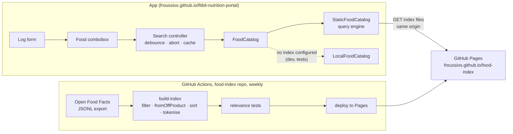

# Food search: design

Status: proposed, 2 November 2026 (third revision: exact-word matching over a static index, no server).
Milestone M1 ([#3](https://github.com/Froussios/fitbit-nutrition-portal/issues/3)). Decision: [D3 #9](https://github.com/Froussios/fitbit-nutrition-portal/issues/9) (hosting). Work items: section 11.

This document covers typing a food name and picking a product from a dropdown of matches. Barcode lookup
and recent foods reuse the same catalogue but have their own issues.

## 1. Requirements

Set by the owner on 2 November 2026.

| # | Requirement | How the design meets it |
|---|---|---|
| R1 | Search happens as the user types. | Debounced search on every input event, stale responses dropped (section 8.2). |
| R2 | Options appear below the field, like a dropdown. | An editable combobox with a listbox popup (section 3). |
| R3 | Matching and ordering; show the top 10 best matches. Revised: no typo tolerance; every query word must be in the result, in any order; a result ranks higher the more of it the query covers ("chocolate" beats "dark chocolate"). | Exact words, last word as a prefix while typing; ranked by coverage, then popularity (section 4). |
| R4 | One food source for now: Open Food Facts. | The index holds Open Food Facts products only. Generic foods (AUSNUT / OpenNutrition) move to later (DR-12). |
| R5 | Rich visuals in the dropdown: a summary per food, starting with calories per unit. | Two-line rows with kcal per 100 g / 100 ml and per serving, built from a summary view model that can grow (section 3.3). |
| R6 | Arrow keys move through the options; the selected row is filled into the input. | Keyboard model in section 3.2; the typed query is kept so Escape and ArrowUp can restore it. |
| R7 | Open Food Facts is large and its APIs throttle; the hosting must support the search over the dataset, and cost nothing a month. The dataset may be slimmed (drop fields and dead rows). | A slimmed, pre-sorted word index built weekly by a GitHub Action and served as static files from GitHub Pages. No server (section 5). |

## 2. Scope

**In:** typed search over Open Food Facts products; the dropdown; choosing a product into the log form; the
index builder; publishing the index; a `FoodCatalog` that queries it.

**Not in this design:**

* Barcode scanning ([#36](https://github.com/Froussios/fitbit-nutrition-portal/issues/36)). It uses `FoodCatalog.get()`, which this design provides (a barcode map in the index).
* Recent foods ([#14](https://github.com/Froussios/fitbit-nutrition-portal/issues/14)). The dropdown is where they would appear when the field is empty; not built here.
* Generic foods (AUSNUT / OpenNutrition): parked as [#38](https://github.com/Froussios/fitbit-nutrition-portal/issues/38). If the coverage test ([#15](https://github.com/Froussios/fitbit-nutrition-portal/issues/15))
  misses the target, they are the first thing to add.
* Typo tolerance. Dropped from R3; section 4.4 lists cheap additions if misses show it is needed.
* Product images, Nutri-Score, macro bars. The row layout leaves room for them (section 3.3).
* kJ display preference ([#21](https://github.com/Froussios/fitbit-nutrition-portal/issues/21)). Rows show kcal for now.

## 3. User experience

### 3.1 Behaviour

The **Food** field in the log form becomes a text input with a dropdown under it.

1. The user types. From 2 characters on, the app searches after a 100 ms pause in typing (R1).
2. Up to 10 matches appear below the field, best first (R2, R3). After them comes a fixed action row,
   **Custom food "…"**, which opens the existing custom-food fields with the typed text as the name. It is
   not counted in the 10.
3. The user picks a row with the mouse, a tap, or the keyboard (section 3.2). The input shows the chosen
   food's label (`Name (Brand)`), the list closes, focus moves to **Amount**, and the units and portions
   refresh as they do now.
4. If the user edits the text after choosing, the choice is cleared and the form cannot be submitted until
   a food is chosen again. This stops an entry being logged against a food the field no longer names.

| State | Shown |
|---|---|
| Fewer than 2 characters | No list (later: recent foods, #14) |
| Searching, no previous results | List with a single "Searching…" row, only if the request takes more than 300 ms |
| Searching, previous results shown | Previous results stay; a small spinner in the field after 300 ms. No flicker between keystrokes. |
| Results | Up to 10 rows, then the custom-food row, then an attribution line |
| No results | "No match for "…"" and the custom-food row |
| Error (offline, index unreachable) | "Food search is unavailable right now" and the custom-food row. The next keystroke retries. |

### 3.2 Keyboard (R6)

The field follows the WAI-ARIA *editable combobox with list autocomplete* pattern. The app keeps two
values: the **typed query** (what the user typed) and the **active row** (none, or 1–10 plus the
custom-food row).

| Key | List closed | List open |
|---|---|---|
| Typing | Opens the list and searches | Clears the active row and searches the field's new text |
| ArrowDown | Opens the list (if there is a query) | Next row. The active row's label is written into the field. From the last row it returns to the field with the typed query restored. |
| ArrowUp | – | Previous row, label written into the field. From the first row it returns to the typed query. |
| Enter | Submits the form only if a food is already chosen | Chooses the active row. With no active row: does nothing (no accidental pick). |
| Tab | Normal focus move | Chooses the active row if there is one, then moves focus normally |
| Escape | Clears the field | With an active row: restores the typed query and clears the active row. Otherwise closes the list. |
| Home / End | Caret in the field | Caret in the field (rows are reached with the arrows) |

Writing a row's label into the field sets `input.value` directly. That does not fire an `input` event, so
it does not start a new search. If the user then types, the search runs on the field's text as it now
reads, so a row can be picked with the arrows and refined by typing.

Mouse hover highlights a row but does not write into the field; a click or tap chooses it.

### 3.3 Rows (R5)

```
┌──────────────────────────────────────────────────────────────┐
│ Weet-Bix Wholegrain Cereal                 358 kcal / 100 g  │
│ Sanitarium · 575 g                      107 kcal / 30 g serv │
├──────────────────────────────────────────────────────────────┤
│ Weet-Bix Blends Multi-Grain                378 kcal / 100 g  │
│ Sanitarium · 510 g                                           │
├──────────────────────────────────────────────────────────────┤
│ + Custom food "weetbix"                                      │
├──────────────────────────────────────────────────────────────┤
│ Food data: Open Food Facts (ODbL)                            │
└──────────────────────────────────────────────────────────────┘
(values illustrative)
```

* **Line 1:** product name, with the matched parts in bold. Right: kcal per 100 g or per 100 ml (the
  food's `basis`), always shown, so rows compare like for like.
* **Line 2:** brand · pack size (Open Food Facts `quantity`). Right: kcal per serving when the product has a
  serving size, e.g. `107 kcal / 30 g serving`.
* A row is built from a `FoodSummary` view model computed from the `FoodItem` by a pure function in
  `src/core/`. Later visuals (a thumbnail, a macro bar, Nutri-Score) are new fields on that model and new
  cells in the row; the search contract does not change.
* Open Food Facts text is user-contributed. It is always rendered with `textContent`, never as HTML
  (section 6.6).

### 3.4 Accessibility and mobile

* Input: `role="combobox"`, `aria-autocomplete="list"`, `aria-expanded`, `aria-controls` pointing at the
  list, `aria-activedescendant` pointing at the active row. List: `role="listbox"`; rows: `role="option"`
  with `aria-selected` on the active one. A polite live region announces "10 results" / "No results".
* Touch targets at least 44 px high; the list is the field's width and scrolls inside the viewport above
  the on-screen keyboard.
* `autocomplete="off"`, `autocapitalize="none"`, `spellcheck="false"` so the browser's own suggestions do not
  cover the list.
* No search while an IME composition is in progress (`compositionstart` / `compositionend`).

## 4. Matching and ordering (R3)

### 4.1 Words

Product names, brands and queries go through the same tokeniser, shared by the index builder and the app
(`src/core/tokens.ts`):

* Lower case; accents removed (`crème` → `creme`); split on anything that is not a letter or digit.
* Stop words dropped: `and`, `with`, `of`, `the`, `in`, `&`, and a few more (list in the repo).
* Hyphenated and apostrophe words are indexed both split and joined: `Weet-Bix` → `weet`, `bix`, `weetbix`;
  `McDonald's` → `mcdonald`, `s`, `mcdonalds`. So `weetbix`, `weet bix` and `weet-bix` all find it.
* Query: trimmed and tokenised the same way. Fewer than 2 characters in total: no search. A query of only
  8, 12, 13 or 14 digits is also treated as a barcode (section 6.4): an exact hit is shown first.

### 4.2 Matching

* **Every query word must appear** as a word in the product's name or brand. Order does not matter.
* **The last word is a prefix** while the user is still typing: `dark choc` matches `Dark Chocolate`.
  Without this nothing would show until a word was finished. A trailing space marks the last word as
  complete. A last word of 1 letter is ignored until the second letter.
* **No typo tolerance.** `chocolat` still finds `chocolate` (prefix), but `chocloate` finds nothing.

### 4.3 Ordering

**Coverage** is how much of the product's name the query accounts for:

```
coverage = query words found in the name / words in the name      (stop words not counted)
```

`chocolate` → `Chocolate` 1/1, `Dark chocolate` 1/2, `Dark chocolate with almonds` 1/3. Higher coverage
first; equal coverage is broken by **popularity**:

```
popularity = log10(1 + unique_scans_n)       how often Open Food Facts apps have scanned it
           + 2 if sold in Australia          (countries_tags has en:australia)
           + completeness                    0..1, Open Food Facts' own score
```

**Pre-sorted index.** When every query word is in the name, coverage is the same fraction for every match
with the same number of name words. So the order is simply: fewer name words first, then more popular. That
order does not depend on the query, so the builder numbers the products in it (document ID 0 is the
shortest-named, most popular product). Every word's list of products is stored in ID order, and the first
10 products that contain all query words are the top 10. A search never needs to see all the matches for a
common word like `chocolate`, only their first few hundred. This is what makes static files fast enough.

The order is approximate in one case: a query word found only in the brand (`cadbury chocolate` against
`Dairy Milk Chocolate`, brand Cadbury) does not lower that product's rank as the coverage formula would.
The relevance tests (section 10) show whether that matters.

### 4.4 If exact words prove too strict

Cheap additions that fit the same index, to consider only if the coverage test or daily use shows misses:

* **Synonyms** applied to the query (`coke` → `coca cola`, `choc` → `chocolate`), as a small table in the app.
* **"Did you mean"**: when a word is not in the dictionary, suggest dictionary words one edit away (the
  client already holds that dictionary shard).
* **Plurals**: index a simple singular form (`biscuits` → `biscuit`).

## 5. Hosting (R7, decision D3)

Owner constraints (2 November 2026): **no monthly bill**; the dataset may be slimmed; exact-word matching
is acceptable (section 4). That combination removes the need for a search engine.

### 5.1 Slimming the dataset

**Rows.** The builder drops:

1. Products without a name (`product_name`, falling back to `product_name_en`).
2. Products that fail `fromOffProduct()`: no usable energy value.
3. Implausible energy (below 0 or above 900 kcal per 100 g/ml).
4. Products flagged obsolete.
5. Optionally, by a **popularity floor**: products never scanned and not sold in Australia. This is the
   main size knob.
6. Duplicates (same words in name and brand, same kcal per 100) are collapsed in the word index to the most
   popular one. All of them stay reachable by barcode.

**Fields.** Of the hundreds of fields in an Open Food Facts record, the index keeps what the app shows or
logs: barcode, name, brand, pack size, basis, energy and the 14 other nutrients in `NUTRIENTS`, portions
(serving and pack), and popularity. The builder runs `fromOffProduct()` and stores the resulting
`FoodItem` in a compact array, so the normaliser stays the single place that interprets Open Food Facts
data; it just runs at build time. About 150 bytes per product.

**Scope.** A setting chooses the rows: `au` (products sold in Australia) or `world` (everything that
survives the filters). Both use the same format and code.

### 5.2 Sizes (estimates, measured by the first build)

| | `au` | `world` |
|---|---|---|
| Products after filters | 80–100 k | 1.5–2.5 M (from about 4 M) |
| Product records (~150 B each) | ~15 MB | 225–375 MB |
| Word lists, dictionary, prefix lists | ~5 MB | 60–120 MB |
| Barcode map | ~2 MB | 30–45 MB |
| **Total** | **~25 MB** | **~300–550 MB** |
| Files | ~1 k | up to ~18 k |

Network access to Open Food Facts was blocked when this was written; the product counts come from search
results (about 4 M products in 2025; Australian products growing about 1,300 a month in Nov 2024). If
`world` does not fit the limits below, the popularity floor shrinks it.

### 5.3 Free hosts compared

Traffic at Google's 100-user cap (V9): about 6,000 searches a day, 180,000 a month.

| Host | Free limits | `au` | `world` | Verdict |
|---|---|---|---|---|
| **GitHub Pages** (static files) | 1 GB per site, 100 GB/month soft bandwidth, Actions deploy | Yes | Yes | **Recommended** |
| Cloudflare Pages (static files) | 20,000 files and 25 MiB per file; bandwidth not capped (third-party reports) | Yes | Yes, keeping under 20 k files | Alternative if GitHub's limits bite |
| Cloudflare Workers + D1 (SQLite FTS5) | 500 MB per database, 5 GB total, 5 M rows read and 100 k rows written per day | Yes | **No**: loading 2 M rows takes about 20 days of the write allowance, and every rebuild again | `au` only |
| Turso (SQLite FTS5) | 5 GB, 500 M rows read and 10 M rows written a month | Yes | Barely: one full rebuild a month; and a database token in the browser lets anyone spend the read allowance, so it needs a Worker in front | Not worth the extra moving parts |
| Supabase (Postgres full-text) | 500 MB database; pauses after a week without use | Yes | **No** (size) | `au` only |
| Algolia free | 1 M records, 10 k searches a month | – | – | **No**: 180 k searches a month |
| Oracle Always Free + Meilisearch | Arm VM; reclaimed if idle; capacity shortages | Yes | Yes | Only if typo tolerance comes back |

### 5.4 Recommendation

**A static, pre-sorted word index on GitHub Pages, built weekly by a GitHub Action.**

* **Free and no server.** No DR-01 exception, no home exposure, no rate limits to manage, no uptime to
  watch. It is the same kind of hosting the app already uses.
* **Same origin.** Published from a second repository (`food-index`) to `froussios.github.io/food-index/`,
  it shares the app's origin (`froussios.github.io`), so no CORS setup.
* **Share-alike for free.** The index is a derivative database under ODbL; publishing it openly, with the
  licence file at its root, is exactly what share-alike asks.
* **Offline later.** Index files are plain cacheable files, so M2's offline mode ([#20](https://github.com/Froussios/fitbit-nutrition-portal/issues/20)) can keep the ones a
  user has fetched.
* **Privacy.** No query text leaves the browser. The host sees which index files are fetched, which hints at
  words searched, but nothing ties them to a person beyond the IP address.
* **Start with `world`** if it fits under about 800 MB; otherwise raise the popularity floor or use `au`.
  The coverage test (#15) runs against both.

The previous designs (Meilisearch on a paid VM, then on a home server) remain the path if typo tolerance
becomes a requirement again; the `FoodCatalog` interface hides the difference.

## 6. Architecture



### 6.1 Index files

```
current.json                     { "version": "2026-11-08" }  (the only file whose content changes between builds)
<version>/
  meta.json                      build and export dates, counts, scope, shard sizes, licence
  LICENSE.txt                    ODbL notice and attribution
  dict/<ab>.json                 every word starting with "ab": [word, product count, where its list is]
  post/<nnnn>.bin                short product lists, packed by a hash of the word (4,096 packs)
  big/<word id>/<k>.bin          chunk k (4,096 IDs each) of a long product list
  pfx/<ab>.bin                   2- and 3-letter prefixes with many expansions: first 1,000 IDs of their union
  rec/<nnnn>.json                product records, 512 per file, by ID
  code/<nnnn>.json               barcode → ID, by a hash of the barcode (2,048 files)
```

* **Product lists** are sorted ID lists, stored as deltas in variable-length integers (about 2 bytes per
  entry). Because IDs follow the ranking, the first chunk of a list holds its best products.
* **Records** are compact arrays decoded into `FoodItem`:
  `[code, name, brand, basis, kcal, [nutrients in NUTRIENT_KEYS order], [[portion, amount, unit], …], quantity]`.
* **Versioned folders** let the next build replace everything at once. The app reads `current.json` at
  start; if an index file returns 404 (a new build was published mid-session), it rereads
  `current.json` and retries once.
* GitHub Pages serves every file with a 10-minute cache and ETags. Files are effectively immutable within a
  version, so revalidation is cheap.

### 6.2 Query engine (`StaticFoodCatalog`)

For a query `dark choc`:

1. **Words.** Tokenise (section 4.1). `dark` is complete; `choc` is the last word, a prefix.
2. **Dictionary.** Fetch `dict/da.json` and `dict/ch.json` (cached after the first time). If a complete word
   is not in the dictionary, there are no results (every word must match).
3. **Prefix expansion.** Words in `dict/ch.json` that start with `choc`, most common first. Up to 16 of them
   are used; rarer expansions (usually misspellings) are skipped. For a 2- or 3-letter last word with more
   expansions than that, the precomputed `pfx/` list is used instead.
4. **Product lists.** Open a lazy iterator per complete word and a merged iterator over the prefix's
   expansions. Each fetches chunks only when the walk reaches them.
5. **Intersect** in ID order (leapfrogging the shortest list) and stop at the first 10 matches.
6. **Records.** Fetch the record files holding those IDs (often one or two, because good matches cluster at
   low IDs), decode to `FoodItem`, and compute highlight runs from the query words.

Fetches per keystroke after the first few: usually 0–2 list chunks and 1–3 record files, all small and
mostly cached. Section 9 sets the budget.

### 6.3 Client contract

`FoodCatalog` gains an abort signal, a result limit, and match ranges for highlighting:

```ts
export interface TextRun { readonly text: string; readonly match: boolean }

export interface FoodSearchHit {
  readonly food: FoodItem;
  /** Name and brand split into matched and unmatched runs, for bold highlights. */
  readonly name: readonly TextRun[];
  readonly brand?: readonly TextRun[];
}

export interface FoodCatalog {
  /** Best matches first. `limit` defaults to 10. */
  search(query: string, options?: { limit?: number; signal?: AbortSignal }): Promise<FoodSearchHit[]>;
  /** Exact lookup, e.g. by barcode. */
  get(ref: FoodRef, options?: { signal?: AbortSignal }): Promise<FoodItem | undefined>;
}
```

* `StaticFoodCatalog` (`src/food/static-catalog.ts`) implements it over the index files with `fetch`.
* `LocalFoodCatalog` gets the same matching and ordering rules (shared tokeniser and coverage function), so
  the UI behaves identically in development and tests without the index.
* `main.ts` stops loading the whole catalogue up front (`catalog.search("")`); the log form receives the
  catalogue instead of an array of foods.

### 6.4 Barcode lookup

`get({ source: "off", id })`: fetch `code/<hash(id)>.json`, find the ID, fetch its record file. Two small
fetches. Open Food Facts stores some products as UPC-A (12 digits) and some as EAN-13 with a leading 0; the
lookup tries both forms.

### 6.5 Configuration

| Variable | Meaning |
|---|---|
| `VITE_FOOD_INDEX_URL` | Base URL of the index, e.g. `https://froussios.github.io/food-index/` |

Without it the app uses `LocalFoodCatalog`.

### 6.6 Security

* Open Food Facts text is user-contributed and untrusted. It is rendered with `textContent` only (the
  existing `el()` helper already does this), and records are parsed as JSON, never evaluated.
* The index is public data on a public host; there are no keys and nothing to write to.

## 7. Index builder

A Node script (`pipeline/build-index.ts`) in this repository, run weekly (and on demand) by a GitHub Action
in the `food-index` repository, which deploys the output to that repository's GitHub Pages.

1. **Download** the Open Food Facts JSONL export, streamed and decompressed on the fly. If the runner is too
   slow, the Parquet export read with DuckDB fetches only the columns we need.
2. **Slim** the rows and fields (section 5.1). `fromOffProduct()` is imported from `src/core/off.ts`.
3. **Score and sort**: popularity, name word count, then assign IDs in ranking order.
4. **Tokenise** names and brands (`src/core/tokens.ts`), build product lists, the dictionary, prefix lists,
   record files and the barcode map.
5. **Check limits**: total size under 800 MB, files under 18,000, no file over 20 MB. Fail the run otherwise.
6. **Test**: run the relevance suite (section 10) against the built files with the real query engine. On
   failure, stop; the published index is untouched.
7. **Deploy** to GitHub Pages, then update `current.json`.

**Licence.** The app shows "Food data: Open Food Facts (ODbL)" with a link in the dropdown and the footer;
the published index carries the ODbL notice.

## 8. Client implementation

### 8.1 Combobox

* `src/ui/food-combobox.ts`: DOM, events and ARIA.
* `src/ui/combobox-state.ts`: the keyboard model in section 3.2 as a pure reducer
  (`state, event → state`), so every row in that table becomes a unit test without a DOM.
* `src/core/food-summary.ts`: `FoodItem → FoodSummary` (kcal per 100, basis, per-serving kcal and label).

### 8.2 Search controller

A small class between the combobox and `FoodCatalog`, unit-tested with fake timers and a fake catalogue:

* **Debounce** 100 ms after the last keystroke.
* **Cancel** the previous search with `AbortController` when a new one starts.
* **Drop stale results**: a result is used only if its query still equals the current query.
* **Cache** the last 50 queries (LRU), so Backspace and repeated searches are instant. Index files are also
  cached in memory by the query engine for the session.
* **Errors**: one error state; never throw into the UI; retry on the next keystroke.

## 9. Performance budgets

| Measure | Target |
|---|---|
| Last keystroke → rows on screen, Australian broadband, p95 | ≤ 250 ms (100 ms debounce + fetches + render) |
| Data fetched for a search after the first few, typical | ≤ 50 KB |
| Data fetched for the very first search of a session | ≤ 300 KB |
| Added JavaScript for the combobox and query engine | ≤ 15 KB gzipped |

GitHub Pages is served through a CDN with Australian edge locations; measure early from a phone on mobile
data. If it misses the budget, Cloudflare Pages is a drop-in alternative.

## 10. Testing

* **Unit (Vitest):** tokeniser (split, join, accents, stop words); coverage and ordering; the query engine
  against a tiny index built in the test (exact words, any order, prefix, no-match, chunk boundaries,
  barcode lookup); keyboard reducer (every row of section 3.2); search controller (debounce, abort, stale
  results, cache, errors); highlight runs; `FoodSummary`.
* **Relevance suite** (`pipeline/relevance.json`): queries with the product expected in the top N, for
  example `weet bix`, `weetbix`, `vegemite`, `coke zero`, `big mac`, `tim tam`, `sanitarium weet`,
  `chocolate` (a plain "Chocolate" product before "Dark chocolate"). Runs against every build before deploy.
  The coverage test list ([#15](https://github.com/Froussios/fitbit-nutrition-portal/issues/15)) is folded into it.
* **Manual:** keyboard-only and screen-reader pass (VoiceOver on iOS, TalkBack on Android), phone and
  desktop.

## 11. Work items

| Order | Issue | What |
|---|---|---|
| 1 | [#9](https://github.com/Froussios/fitbit-nutrition-portal/issues/9) Decision D3 | Confirm the static index on GitHub Pages; no server |
| 2 | [#12](https://github.com/Froussios/fitbit-nutrition-portal/issues/12) Index builder and `StaticFoodCatalog` | Sections 4, 5.1, 6, 7 |
| 2 | [#15](https://github.com/Froussios/fitbit-nutrition-portal/issues/15) Coverage spike | As soon as the builder runs locally; compare `au` and `world` |
| 3 | [#37](https://github.com/Froussios/fitbit-nutrition-portal/issues/37) Publish the food index | `food-index` repository, weekly Action, Pages, size checks |
| 4 | [#13](https://github.com/Froussios/fitbit-nutrition-portal/issues/13) Search-as-you-type UI | Sections 3, 8 |
| 5 | [#36](https://github.com/Froussios/fitbit-nutrition-portal/issues/36) Barcode lookup | Camera and manual entry, via `get()` |
| 6 | [#14](https://github.com/Froussios/fitbit-nutrition-portal/issues/14) Recent foods | Unchanged; shows in the empty dropdown |

## 12. Open questions

* **Real sizes.** Products surviving the filters and the total index size decide `world` versus `au` and
  the popularity floor. Measured by the first build.
* **Exact words in practice.** Whether misses (misspellings, `timtam` vs `Tim Tam`, plurals) are common
  enough to add the section 4.4 helpers.
* **Brand-only matches.** Whether the approximation in section 4.3 orders `cadbury chocolate` well enough.
* **Duplicates.** Whether collapsing same-name, same-energy products hides pack sizes people want to see.
* **Per-serving kcal.** Open Food Facts serving sizes are sometimes wrong. If the coverage test finds many,
  show per-serving values only when they agree with the per-100 values.
