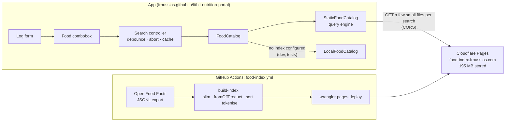

# Food search: design

Status: live since 5 November 2026 (whole world dataset; exact-word matching over a static index queried
file by file from the browser; no server). The index is deployed to Cloudflare Pages by a GitHub Action, is
never committed to git, and is served at `https://food-index.froussios.com/` (decision DR-14).
Milestone M1 ([#3](https://github.com/Froussios/fitbit-nutrition-portal/issues/3)). Decision: DR-14 (hosting; was D3, [#9](https://github.com/Froussios/fitbit-nutrition-portal/issues/9)). Work items: section 11.

This document covers typing a food name and picking a product from a dropdown of matches. Barcode lookup
and recent foods reuse the same catalogue but have their own issues.

## 1. Requirements

Set by the owner on 2 November 2026.

| # | Requirement | How the design meets it |
|---|---|---|
| R1 | Search happens as the user types. | Debounced search on every input event, stale responses dropped (section 8.2). |
| R2 | Options appear below the field, like a dropdown. | An editable combobox with a listbox popup (section 3). |
| R3 | Matching and ordering; show the top 10 best matches. Revised: no typo tolerance; every query word must be in the result, in any order; a result ranks higher the more of it the query covers ("chocolate" beats "dark chocolate"). Revised 5 November 2026 (DR-15): unless given evidence otherwise, assume the generic product. | Exact words, last word as a prefix while typing; ranked by where the words matched, generic before branded, then coverage, then popularity (section 4). |
| R4 | One food source for now: Open Food Facts. Revised 5 November 2026 (DR-16): generic foods come from authoritative sources, and every row shows its source. | Open Food Facts holds products only. A small file of AFCD and USDA FNDDS foods is searched in the browser and shown first (section 13). |
| R5 | Rich visuals in the dropdown: a summary per food, starting with calories per unit. | Two-line rows with energy (kcal or kJ, per DR-21) per 100 g / 100 ml and per serving, built from a summary view model that can grow (section 3.3). |
| R6 | Arrow keys move through the options; the selected row is filled into the input. | Keyboard model in section 3.2; the typed query is kept so Escape and ArrowUp can restore it. |
| R7 | Open Food Facts is large and its APIs throttle; host our own copy of the **whole world** dataset (Australian tagging is incomplete), at no monthly cost, without the browser downloading it. The dataset may be slimmed (drop fields and dead rows). | A slimmed, pre-sorted word index built weekly by a GitHub Action and stored as static files on Cloudflare Pages. The browser fetches only the files each search needs, often hundreds of KB while typing (sections 5 and 9.1). |
| R8 | Set 6 November 2026: products logged recently are likely to be logged again. A major boost for the last 20 products and for the last 2 weeks: they appear in the suggestions. A minor boost for a food logged at any time: favoured only if a good match. The history must not be searched exhaustively. | One request for the newest entries, in the background; matching foods go first (section 14). |

## 2. Scope

**In:** typed search over Open Food Facts products; the dropdown; choosing a product into the log form; the
index builder; publishing the index; a `FoodCatalog` that queries it.

**Not in this design:**

* Barcode lookup by manual entry ([#36](https://github.com/Froussios/fitbit-nutrition-portal/issues/36)). It uses `FoodCatalog.get()`, which this design provides (a barcode map in the index).
* Recent foods in the empty dropdown, and "log again" ([#14](https://github.com/Froussios/fitbit-nutrition-portal/issues/14)). Not built here. Foods logged before already rank higher once something is typed (section 14).
* AUSNUT 2023 and more USDA data: [#38](https://github.com/Froussios/fitbit-nutrition-portal/issues/38), and section 13.
* Typo tolerance. Dropped from R3; section 4.4 lists cheap additions if misses show it is needed.
* Product images, Nutri-Score, macro bars. The row layout leaves room for them (section 3.3).

## 3. User experience

### 3.1 Behaviour

The **Food** field in the log form becomes a text input with a dropdown under it.

1. The user types. From 2 characters on, the app searches after a 100 ms pause in typing (R1).
2. Up to 10 matches appear below the field, best first (R2, R3). After them comes a fixed action row,
   **Custom food "…"**, which opens the existing custom-food fields with the typed text as the name. It is
   not counted in the 10.
3. The user picks a row with the mouse, a tap, or the keyboard (section 3.2). The input shows the chosen
   food's label (`Name (Brand)`), the list closes, focus moves to **Amount**, and the units and portions
   refresh as they do now (after one small fetch of the product's full nutrients).
4. If the user edits the text after choosing, the choice is cleared and the form cannot be submitted until
   a food is chosen again. This stops an entry being logged against a food the field no longer names.

| State | Shown |
|---|---|
| Fewer than 2 characters | No list (later: recent foods, #14) |
| Searching, no previous results | List with a single "Searching…" row, only if the request takes more than 300 ms |
| Searching, previous results shown | Previous results stay; a small spinner in the field after 300 ms. No flicker between keystrokes. |
| Results | Up to 10 rows, then the custom-food row, then an attribution line |
| No results | "No match for "…"" and the custom-food row |
| Error (offline, index unreachable) | "Food search is unavailable right now" and the custom-food row. The next keystroke retries. |

### 3.2 Keyboard (R6)

The field follows the WAI-ARIA *editable combobox with list autocomplete* pattern. The app keeps two
values: the **typed query** (what the user typed) and the **active row** (none, or 1–10 plus the
custom-food row).

| Key | List closed | List open |
|---|---|---|
| Typing | Opens the list and searches | Clears the active row and searches the field's new text |
| ArrowDown | Opens the list (if there is a query) | Next row. The active row's label is written into the field. From the last row it returns to the field with the typed query restored. |
| ArrowUp | – | Previous row, label written into the field. From the first row it returns to the typed query. |
| Enter | Submits the form only if a food is already chosen | Chooses the active row. With no active row: does nothing (no accidental pick). |
| Tab | Normal focus move | Chooses the active row if there is one, then moves focus normally |
| Escape | Clears the field | With an active row: restores the typed query and clears the active row. Otherwise closes the list. |
| Home / End | Caret in the field | Caret in the field (rows are reached with the arrows) |

Writing a row's label into the field sets `input.value` directly. That does not fire an `input` event, so
it does not start a new search. If the user then types, the search runs on the field's text as it now
reads, so a row can be picked with the arrows and refined by typing.

Mouse hover highlights a row but does not write into the field; a click or tap chooses it.

### 3.3 Rows (R5)

```
┌──────────────────────────────────────────────────────────────┐
│ Weet-Bix Wholegrain Cereal                 358 kcal / 100 g  │
│ Sanitarium · 575 g [Open Food Facts] 🇦🇺 107 kcal / 2 biscui… │
├──────────────────────────────────────────────────────────────┤
│ Weet-Bix Blends Multi-Grain                378 kcal / 100 g  │
│ Sanitarium · 510 g [Open Food Facts] 🇦🇺 +1                  │
├──────────────────────────────────────────────────────────────┤
│ + Custom food "weetbix"                                      │
├──────────────────────────────────────────────────────────────┤
│ Food data: Open Food Facts (ODbL)                            │
└──────────────────────────────────────────────────────────────┘
(values illustrative)
```

* **Line 1:** product name, with the matched parts in bold. Right: energy in the chosen unit (DR-21) per 100 g or per 100 ml (the
  food's `basis`), always shown, so rows compare like for like.
* **Line 2:** brand · pack size (Open Food Facts `quantity`), or **Generic** for a food from an authoritative
  source, or **No brand listed** for an Open Food Facts product with no brand. Then a tag naming the row's source,
  so a bad value can be traced to its database: `Open Food Facts`, `AFCD` or `FNDDS`. Then a small flag for where the
  food is sold: Australia's if the product lists it, else the first country listed, then `+N` for the others; the
  tooltip names them all. Generic foods show their database's country (AFCD 🇦🇺, FNDDS 🇺🇸). No flag when Open Food
  Facts lists no country, which doesn't mean the product isn't sold here (section 5). Flags are emoji, which Windows
  draws as two letters (`AU`). Right: energy per serving when the product has a serving size, e.g. `107 kcal / 2 biscuits (30 g)`.
  A serving that is only a weight or volume, such as `30 g`, is not shown, since it repeats the per-100 figure in another
  size (DR-28).
* A row is built from a `FoodSummary` view model computed from the `FoodItem` by a pure function in
  `src/core/`. The index builder runs the same function, so search results arrive as summaries and the full
  food is fetched only when chosen. Later visuals (a thumbnail, a macro bar, Nutri-Score) are new fields on that model and new
  cells in the row; the search contract does not change.
* Open Food Facts text is user-contributed. It is always rendered with `textContent`, never as HTML
  (section 6.6).

### 3.4 Accessibility

* Input: `role="combobox"`, `aria-autocomplete="list"`, `aria-expanded`, `aria-controls` pointing at the
  list, `aria-activedescendant` pointing at the active row. List: `role="listbox"`; rows: `role="option"`
  with `aria-selected` on the active one. A polite live region announces "10 results" / "No results".
* The list is the field's width and scrolls inside the viewport.
* `autocomplete="off"`, `autocapitalize="none"`, `spellcheck="false"` so the browser's own suggestions do not
  cover the list.
* No search while an IME composition is in progress (`compositionstart` / `compositionend`).

## 4. Matching and ordering (R3)

### 4.1 Words

Product names, brands and queries go through the same tokeniser, shared by the index builder and the app
(`src/core/tokens.ts`):

* Lower case; accents removed (`crème` → `creme`); split on anything that is not a letter or digit.
* Stop words dropped: `and`, `with`, `of`, `the`, `in`, `&`, and a few more (list in the repo).
* Hyphenated and apostrophe words are indexed both split and joined: `Weet-Bix` → `weet`, `bix`, `weetbix`;
  `McDonald's` → `mcdonald`, `s`, `mcdonalds`. So `weetbix`, `weet bix` and `weet-bix` all find it.
* Query: trimmed and tokenised the same way. Fewer than 2 characters in total: no search. A query of only
  8, 12, 13 or 14 digits is also treated as a barcode (section 6.4): an exact hit is shown first.

### 4.2 Matching

* **Every query word must appear** as a word in the product's name or brand. Order does not matter.
* **The last word is a prefix** while the user is still typing: `dark choc` matches `Dark Chocolate`.
  Without this nothing would show until a word was finished. A trailing space marks the last word as
  complete. A last word of 1 letter is ignored until the second letter.
* **No typo tolerance.** `chocolat` still finds `chocolate` (prefix), but `chocloate` finds nothing.

### 4.3 Ordering

**Principle (DR-15): unless given evidence otherwise, assume the generic product.** Brands often name a product
after a flavour, so a word in the name says more about what a product is than the same word in its brand.

Foods the user logged before come first (section 14, DR-19). Generic foods come from authoritative sources and are
shown next (section 13, DR-16). Open Food Facts products follow, ordered by these rules, each one only breaking ties in the one before (`matchRank` in
`src/core/tokens.ts`):

| # | Rule | Example, searching `vanilla` |
|---|---|---|
| 1 | **Tier.** Every query word whole, in the name or brand, with at least one in the name; then the last word only as the start of a longer word (`coke` in `cokelat`); then nothing matched in the name. | `Yogurt (Vanilla Queen)` is last |
| 2 | **The query uses up the whole branded product,** name and brand. There is nothing more to type to reach such a product, so nothing else may push it down. | Searching `vegemite`: `Vegemite (Vegemite)` before `Vegemite pretzels` |
| 3 | **A query word is the food, not its flavour or an ingredient** (below). | Searching `chocolate`: `Dark chocolate` before `Chocolate milk`. Searching `vegemite`: `Vegemite (Bega)` before `Vegemite pretzels` |
| 4 | **Branded before no brand listed.** A crowdsourced product with no brand is just incomplete; it is not generic. | `Vanilla extract (Queen)` before `Vanilla extract` |
| 5 | **Fewer extra words:** name words that are not query words. | `Vanilla (Queen)` before `Vanilla extract (Queen)` |
| 6 | **More query words in the name.** | `Vanilla queen (Other)` before `Vanilla extract (Queen)`, searching `vanilla queen` |
| 7 | **More query words in the brand as well.** | `Vanilla (Vanilla Queen)` before `Vanilla (Queen)` |
| 8 | **More popular** (below). | |

**Food or flavour (rule 3).** `headWords` in `src/core/tokens.ts` uses word position. English puts the food last, so
`Dark chocolate` is a chocolate and `Chocolate milk` is a milk. Sizes (`455g`) and anything after `with`, `in`, a
comma or a dash are ignored first. A short list of form words (`breast`, `flour`, `extract`, `whites`...) passes the
role to the word before them, so `Chicken Breast` is still chicken. Nutrition was tried as a signal and rejected: a
protein cookie is a cookie, but looks nothing like other cookies. Open Food Facts categories scored worse than word
position. A wrong guess only moves a row; nothing is hidden. Measured on hand-labelled rows from foods not used to
build the rule: 90% correct, against 45% for treating every match as the food. Known limits:

* **Compound foods.** `Peanut Butter` counts as a butter. People always say both words, so a user searching `butter`
  has not finished typing. Personal log history helps once the user has logged the food (section 14).
* **Flavour written last.** `Protein Puffs Vegemite` counts as Vegemite.
* **English word order only**, for now.

Popularity is estimated in two steps. First the **number of entries with exactly this name**, of any brand, with
entries sold in Australia counting 10 times. Few records have a scan count, while every record has a name, and this
is what brings `Milk chocolate` (334 entries) above `Probiotic chocolate`. Ties then fall to:

```
popularity = log10(1 + unique_scans_n)       how often Open Food Facts apps have scanned it
           + 2 if sold in Australia          (countries_tags has en:australia)
           + completeness                    0..1, Open Food Facts' own score
```

**Pre-sorted index.** Rules 4, 5 and 8 mostly do not depend on the query, so the builder numbers the products in
this fixed order: branded first, then fewer distinct name words, then fewer distinct words in the name and brand
together, then more entries with the same name, then more popular. A word has three sorted lists of product IDs:
products where it says what the food is, products with it elsewhere in the name, and products with it only in the
brand. Those facts are enough to rank a product without fetching its text:
`meta.json` gives the word counts and branded or not for any ID (`bands`, `unbrandedFrom`), and the lists say
which query words are in the name. A product holding every query word, with as many words in total as the query
has, is used up (rule 2), so the engine can jump straight to those IDs.

Each tier is one pass over the lists (section 6.2). A pass stops as soon as no later product could beat the
10 it has: a later product's extra words are at least its word count minus the number of query words. For a
one-word search that is simply the first 10 IDs after any used-up products. Rule 7 needs the brand text, so it
only orders the 10 chosen products; it cannot bring a product into them. Popularity only separates products with
the same word counts, so among equally good matches a shorter brand comes first.

The order is approximate in two cases: a last word of 2 or 3
letters that many words start with (`milk ch`) checks at most 100 candidates (section 6.2), and rule 7 above.
Tests compare the engine with a brute-force ranking of every product.

### 4.4 If exact words prove too strict

Cheap additions that fit the same index, to consider only if the coverage test or daily use shows misses:

* **Synonyms** applied to the query (`coke` → `coca cola`, `choc` → `chocolate`), as a small table in the app.
* **"Did you mean"**: when a word is not in the dictionary, suggest dictionary words one edit away (the
  client already holds that dictionary shard).
* **Plurals**: index a simple singular form (`biscuits` → `biscuit`).

## 5. Hosting and execution (R7, decision D3)

Owner constraints (2 November 2026):

* **No monthly bill.**
* **The whole world dataset.** Open Food Facts' country tags are incomplete for Australia, so filtering by
  country would lose products sold here. The Australian tag is used only to boost ranking.
* **The dataset may be slimmed** (unused fields and dead rows dropped).
* **Exact-word matching** is acceptable (section 4).
* **The browser must not download the dataset**, not even a 25 MB slice.

### 5.1 Where search runs

The index lives on a static host and is never downloaded whole. **Search runs in the browser, in the query
engine (`StaticFoodCatalog`), which fetches only the few small index files a query needs.** It works like a
database index seek: read the handful of pages that hold the answer, never scan the table. The pre-sorted
order (section 4.3) is what keeps that handful small: the engine reads the head of each word's product list
and stops at 10 matches.

What one search downloads:

| Step | File | Size each (est., compressed) | Fetched |
|---|---|---|---|
| Manifest | Index version and the word range of every dictionary shard | ~20 KB | Once per session |
| Dictionary | The shard holding each query word. Typing more letters usually stays in the same shard. Lists of rare words are stored inline here. | ≤ 16 KB | First time each shard is needed |
| Product lists | Chunks of 4,096 product IDs | 1–8 KB | Usually only the first chunk of each word |
| Row summaries | 256 products per file; the top hits cluster in the first files | ~6 KB | For the 10 hits, mostly cached |
| Product detail | Full nutrients and portions | ~10 KB | Only when the user picks a row |

| | Data over the network (est.) |
|---|---|
| First search of a session | 50–120 KB |
| Each further keystroke | 0–40 KB (often 0: everything needed is cached). **Superseded: see section 9.** |
| A whole logging session of several searches | Well under 1 MB, about one phone photo. **Superseded: see section 9.** |
| Hard cap per search | The engine stops reading lists after 200,000 product IDs (about 256 KB) and returns what it found. Only two common words that rarely appear together (`chocolate chicken`) get near it. |

A search needs up to 3 round trips in sequence (dictionary → lists → summaries). The engine fetches the
dictionary shard as soon as letters are typed, during the 100 ms debounce, which hides the first.

### 5.2 Execution options

The query engine is a pure TypeScript module over one function, `readFile(path)`. It runs unchanged in the
browser, in Node (builder and tests) or in a Cloudflare Worker.

| Engine runs in | Network per keystroke | Infrastructure | Free limits |
|---|---|---|---|
| **The browser** (start here) | 0–40 KB, 1–3 round trips | Static files only | No quota; Cloudflare Pages serves static files without request or bandwidth limits |
| A Cloudflare Worker beside the files | One request, ~3 KB response, 1 round trip | A stateless Worker reading the index from R2 (a DR-01 exception) | 100 k requests/day and 10 ms CPU per request; R2 10 GB storage and 10 M reads/month. Abuse could use up the daily request quota. |

**Start in the browser**: no server, no quota, no exception to DR-01. Measure on desktop from
Australia. If latency misses the budget (section 9) or the data use matters, move the same module into a
Worker; the index does not change.

### 5.3 Slimming the dataset

**Rows.** The builder drops:

1. Products without a name (`product_name`, falling back to `product_name_en`).
2. Products that fail `fromOffProduct()`: no usable energy value.
3. Implausible energy (below 0 or above 900 kcal per 100 g/ml).
4. Products flagged obsolete.
5. Duplicates (same words in name and brand, same kcal per 100) are collapsed in the word index to the most
   popular one. Products with no brand and the same name (every word in order: `Milk chocolate` is neither
   `Chocolate milk` nor `Milk with chocolate`) are collapsed whatever their kcal: without a brand,
   nothing in the dropdown tells them apart, and `Vanilla` would otherwise fill every row. All of them stay
   reachable by barcode.
6. Only if the index exceeds the host's limit: a popularity floor (never scanned and incomplete). Never a
   country filter.

**Fields.** Of the hundreds of fields in an Open Food Facts record, the index keeps what the app shows or
logs, split in two so search fetches only the small part:

* **Summary** (what a dropdown row shows, ~60 bytes): barcode, name, brand, pack size, basis, kcal per 100,
  serving label and amount, and the countries it is sold in as ISO codes (`"AU NZ"`, left out when none; Open Food
  Facts tags mapped by `pipeline/off-countries.ts`). Built by the same `FoodSummary` function the UI uses (section 3.3).
  The countries add about 1% to the gzipped summary files.
* **Detail** (what logging needs, ~120 bytes): the 14 other nutrients in `NUTRIENTS`, portions, density.

The builder runs `fromOffProduct()` and stores its result, so the normaliser stays the single place that
interprets Open Food Facts data; it just runs at build time.

### 5.4 Sizes on the host

**Estimated before the first build**, now superseded by the measured numbers after the table (the real
index is 195 MB in 18,009 files):

| Part | Estimate |
|---|---|
| Products after filters | 1.5–2.5 M (from about 4 M) |
| Summaries | 90–150 MB |
| Details | 180–300 MB |
| Dictionary (names in many languages) | 15–30 MB |
| Product lists and prefix lists | 40–80 MB |
| Barcode map | 30–45 MB |
| **Total stored** | **~350–600 MB** |
| Files | ~25 k |

These are stored on the host; a user downloads only what section 5.1 lists. **Measured on the 2 November
2026 export:** 4,889,627 records read; 900,168 kept
(3.68 M dropped for no usable energy, 290 k for no name, 16 k for implausible energy, 2 k obsolete);
808,377 searchable after collapsing duplicates; 197,937 distinct words. The index is 195 MB in 18,009 files,
none over 0.1 MB, and took 44 minutes to build on a GitHub runner.

### 5.5 Free hosts compared (whole dataset)

Traffic at Google's 100-user cap (V9): about 6,000 search requests a day, 180,000 a month.

| Host | Free limits | Fits? | Verdict |
|---|---|---|---|
| **Cloudflare Pages** (static files, Direct Upload) | 20,000 files and 25 MiB per file; static requests and bandwidth free and unlimited | Yes: the builder sizes its files to stay under 19,000 | **Chosen** |
| GitHub Pages, index committed to git | 1 GB per site, 100 GB/month soft bandwidth | Yes, but every rebuild stays in the git history (150–200 MB each) | Rejected by the owner |
| GitHub release asset unpacked into GitHub Pages | Release assets do not count toward repo size | Yes | Every app deploy re-uploads the index; browsers cannot fetch release assets directly (no CORS) |
| Cloudflare R2 (+ a Worker) | 10 GB, 10 M reads and 1 M writes a month | Yes | For the Worker option (section 5.2) |
| Cloudflare Workers + D1 (SQLite FTS5) | 500 MB per database, 100 k rows written per day | **No**: loading 2 M rows takes about 20 days of write allowance, and every rebuild again | No |
| Turso (SQLite FTS5) | 5 GB, 500 M rows read and 10 M written a month | Barely: one full rebuild a month; a database token in the browser exposes the read allowance | No |
| Supabase (Postgres full-text) | 500 MB database | **No** | No |
| Algolia free | 1 M records, 10 k searches a month | **No**: 180 k searches a month | No |
| Meilisearch on a home server or Oracle Always Free | – | Yes | Only if typo tolerance comes back |

### 5.6 Recommendation

**A slimmed, pre-sorted word index of the whole dataset on Cloudflare Pages, built weekly by a GitHub Action,
queried by an engine in the browser that fetches only what each search needs.** (Owner decision,
2 November 2026: the index must not live in git history, where every rebuild would stay for good.)

* **Free and no server.** No DR-01 exception, no home exposure, no rate limits to manage, no uptime to
  watch. Static files on a CDN with Australian edge locations.
* **Isolation.** A Pages API token can edit every Pages project in its Cloudflare account; it cannot be
  limited to one project. So the index should live in its own free Cloudflare account, the token is kept in
  a GitHub environment limited to `main`, and the workflow only deploys to a project whose live site serves
  this repository's `food-index-owner.json` marker (or to a new, empty one).
* **No git history.** Each deploy replaces the previous one (Direct Upload with Wrangler, which uploads only
  changed files). The app stays on GitHub Pages; Pages sends `Access-Control-Allow-Origin: *` by default,
  so the app can read the index from another origin.
* **Custom domain.** The index is served at `food-index.froussios.com`, a CNAME (at GoDaddy) to the
  project's `food-diary-index.pages.dev`. Some networks intercept `*.pages.dev`: the University of Sydney's
  firewall re-signs its TLS with its own certificate authority. Browsers don't trust that authority, and
  HSTS (`.dev` is preloaded) leaves no way to click through, so the app saw only "Failed to fetch". The
  custom domain is not intercepted there (tested 5 November 2026); that is an observation, not a guarantee.
* **Share-alike for free.** The index is a derivative database under ODbL; publishing it openly, with the
  licence file at its root, is exactly what share-alike asks.
* **No offline search.** The app assumes a connection ([DR-18](DECISIONS.md)), so index files are not kept for
  offline use. They are plain cacheable files, should that ever change.
* **Privacy.** No query text leaves the browser. The host sees which index files are fetched, which hints at
  words searched, but nothing ties them to a person beyond the IP address.
* **A way out.** If latency disappoints, the Worker option (section 5.2) uses the same index and
  engine. If typo tolerance becomes a requirement again, Meilisearch on a home server is the path; the
  `FoodCatalog` interface hides the difference.

## 6. Architecture



### 6.1 Index files

```
_headers                     caches <version>/* for a year as immutable (Cloudflare Pages)
food-index-owner.json        ownership marker checked before each deploy
current.json                 { "version": "20261104T085100Z-<run id>-<attempt>" }  (the only file whose content changes between builds)
<version>/
  meta.json                  the manifest: format, build and export dates, counts, licence, file sizes
                             (sumPerFile, detPerFile, codeBuckets), the first word of every dictionary shard,
                             and what ranks a product from its ID (unbrandedFrom, bands of word counts)
  LICENSE.txt                ODbL notice and attribution
  dict/<n>.json              a run of consecutive words in sorted order (about 24 KB uncompressed), each
                             [word, food list, rest of name list, brand-only list]. A list is null, or [count, IDs] for up to 16,
                             [count, pack, offset, length] for medium lists, [count, -1, list, chunks] for long
  post/<n>.bin               medium lists (17 to 4,096 IDs), packed in dictionary order, about 16 KB per pack
  big/<list>/<k>.bin         chunk k (4,096 IDs) of a long list
  big/<list>/skip.json       the first ID of each chunk, to jump straight to the chunk holding an ID
  pfx/<hex>.json             one file per 2-letter prefix (hex of its UTF-8 bytes): for it and each 3-letter
                             extension, the number of words it starts, and if over 16, the best 200 IDs of
                             their food lists (base64 varint deltas)
  sum/<n>.json               row summaries, sumPerFile per file (256, more if the file budget needs it), by ID
  det/<n>.json               details, detPerFile = 2 × sumPerFile per file (512 or more), by ID
  code/<n>.json              barcode → ID, about 2,048 per file, bucketed by FNV-1a of the barcode
```

* **Dictionary shards are word ranges**, not first letters, so every shard stays small however the words
  are spread across languages. The manifest lists each shard's first word; the engine finds a word's shard
  by binary search. Because the dictionary is sorted, all the words a prefix expands to are next to each
  other, in one shard or two.
* **Product lists** are sorted ID lists, stored as deltas in variable-length integers (1–2 bytes per entry).
  Because IDs follow the ranking, the first chunk of a list holds its best products.
* **Summaries and details** are compact JSON arrays, decoded into `FoodSummary` and `FoodItem`.
* **Versioned folders** let the next build replace everything at once. Every build gets a new version name
  (UTC build time, plus the run ID and attempt in CI), because browsers cache version folders as
  immutable: reusing a name would mix two builds' files. The app reads `current.json` at
  start; if an index file returns 404 (a new build was published mid-session), it rereads `current.json`
  and retries once.
* Version folders never change, so `_headers` lets browsers cache them for a year (`immutable`);
  `current.json` keeps Pages' default of revalidating every time. Pages compresses JSON on the fly.

### 6.2 Query engine (`StaticFoodCatalog`)

For a query `dark choc`:

1. **Words.** Tokenise (section 4.1). `dark` is complete; `choc` is the last word, a prefix.
2. **Dictionary.** Find the shards for `dark` and `choc` from the manifest and fetch them (cached after the
   first time). If a complete word is not in the dictionary, there are no results (every word must match).
3. **Whole words (first tier in section 4.3).** Treat `choc` as a complete word too. Open a lazy iterator per word
   over its name and brand-only lists; each fetches the next chunk only when the walk reaches it. First walk
   only the ID ranges (`bands`) whose products have as many words as the query, which finds the used-up products.
   Then intersect in ID order (leapfrogging from the shortest list), first keeping products where a query word is
   the food, then any with a query word in the name. Each walk stops once no later product could beat the 10
   found, or at the read cap of 200,000 product IDs (about 256 KB). A list read by several passes counts once.
4. **Longer words (second tier), if there is still room.** The words from `choc` up to `chod` in sorted order, most
   common first. Up to 16 are used; rarer expansions (usually misspellings) are skipped. A 2- or 3-letter last
   word with more expansions than that uses its precomputed `pfx/` list when it is the only word; that list holds
   only products where such a word is the food, so a typed `ch` shows no flavour or brand-only matches. After other
   words (`milk ch`), that list (the best 200 IDs overall) would rarely meet theirs, so the engine instead takes
   up to 100 candidates matching the other words, in ID order, and keeps those whose name or brand has a word
   starting with the prefix. A 3-letter word first tries its 16 commonest expansions, which fetches no text, and checks
   candidates only for the rows still empty. On 592 real product names typed up to 3 letters of their last word, this
   cut the median search from 325 KB to 155 KB for common names, and found 95% of rare names, up from 90%. Rare names
   cost a little more, a median of 165 KB up from 143 KB.
5. **Brand only (third tier), if there is still room.** Intersect the brand-only lists. Fixed order is exact here.
6. **Summaries.** Fetch the summary files holding the chosen IDs, put them in final order (`matchRank`) and
   compute highlight runs from the query words.
7. **On choosing a row**, `get()` fetches that product's detail file and assembles the `FoodItem`.

The engine also reads format 2 indexes, where a word has a single list, so the app can ship before the index is
rebuilt. Remove that (`LEGACY_INDEX_FORMAT`, `LegacyDictEntry`) once a format 3 index is live.

### 6.3 Client contract

Search returns summaries; the full food is fetched only when chosen:

```ts
export interface TextRun { readonly text: string; readonly match: boolean }

/** What a dropdown row shows (section 3.3). */
export interface FoodSummary {
  readonly ref: FoodRef;
  readonly name: string;
  readonly brand?: string;
  readonly quantity?: string;          // pack size, e.g. "575 g"
  readonly basis: BaseUnit;
  readonly kcalPer100: number;
  readonly serving?: { readonly label: string; readonly amount: number; readonly kcal: number };
}

export interface FoodSearchHit {
  readonly summary: FoodSummary;
  /** Name and brand split into matched and unmatched runs, for bold highlights. */
  readonly name: readonly TextRun[];
  readonly brand?: readonly TextRun[];
}

export interface FoodCatalog {
  /** Best matches first. `limit` defaults to 10. */
  search(query: string, options?: { limit?: number; signal?: AbortSignal }): Promise<FoodSearchHit[]>;
  /** The full food: on choosing a search hit, or by barcode. */
  get(ref: FoodRef, options?: { signal?: AbortSignal }): Promise<FoodItem | undefined>;
  /** For a catalogue whose answers can change, such as when the user logs a food (section 14). */
  onChange?(listener: () => void): void;
}
```

* `StaticFoodCatalog` (`src/food/static-catalog.ts`) wraps the engine with a `readFile` that uses `fetch`
  and an in-memory cache for the session.
* `LocalFoodCatalog` gets the same matching and ordering rules (shared tokeniser and coverage function), so
  the UI behaves identically in development and tests without the index.
* `main.ts` stops loading the whole catalogue up front (`catalog.search("")`); the log form receives the
  catalogue instead of an array of foods. Choosing a row calls `get()`; the preview shows "Loading…" for
  the one small fetch.

### 6.4 Barcode lookup

`get({ source: "off", id })`: fetch `code/<hash(id)>.json`, find the ID, then its summary and detail files.
Three small fetches. Open Food Facts stores some products as UPC-A (12 digits) and some as EAN-13 with a
leading 0; the lookup tries both forms.

### 6.5 Configuration

| Variable | Meaning |
|---|---|
| `VITE_FOOD_INDEX_URL` | Base URL of the index: `https://food-index.froussios.com/`. CI sets it from the `FOOD_INDEX_URL` repository variable (a repository variable, not a secret or an environment variable). Default: `food-index/` next to the app, for a locally built index in `public/food-index/` (ignored by git). |

If no index is found there, the app logs a warning and uses `LocalFoodCatalog` over the sample foods.

### 6.6 Security

* Open Food Facts text is user-contributed and untrusted. It is rendered with `textContent` only (the
  existing `el()` helper already does this), and index files are parsed as JSON or binary, never evaluated.
* The index is public data on a public host; there are no keys and nothing to write to.

## 7. Index builder

A Node script (`pipeline/build-index.ts`, logic in `pipeline/index-builder.ts`) run by
`.github/workflows/food-index.yml`, weekly and by hand. The workflow streams the export through the builder
and deploys the output to the Cloudflare Pages project `food-diary-index` with `wrangler pages deploy`, which
serves it at `https://food-index.froussios.com/`. Nothing is committed. To build locally from a downloaded export (into `public/food-index/`, ignored by git):
`npm run build:index -- --input openfoodfacts-products.jsonl.gz`.

1. **Download** the Open Food Facts JSONL export, streamed and decompressed on the fly. If the runner is too
   slow, the Parquet export read with DuckDB fetches only the columns we need.
2. **Slim** the rows and fields (section 5.3). `fromOffProduct()` is imported from `src/core/off.ts`.
3. **Score and sort**: popularity, name word count, then assign IDs in ranking order.
4. **Tokenise** names and brands (`src/core/tokens.ts`); build product lists, the range-sharded dictionary,
   prefix lists, summary and detail files and the barcode map.
5. **Fit the file budget**: summary and detail files grow from 256 and 512 products per file until the
   whole index fits in 19,000 files (Cloudflare Pages allows 20,000). Fail if any file exceeds 20 MB.
6. **Switch** `current.json` to the new version folder, delete the old one, and write `_headers`.
7. **Deploy** the folder to Cloudflare Pages (workflow). A deploy replaces the previous one; a session that
   still holds the old version gets a 404, rereads `current.json` and carries on.

Not built yet: the relevance suite against the real index (section 10) and the per-query byte budget check.
The unit tests run the builder and engine on a small fixture.

**Measured on synthetic data** (2 M made-up products with a realistic mix of common and rare words, on a
4-core machine): 94 s and 1.9 GB of memory to build; 471 MB in 15,638 files. Typing a query letter by
letter with a cold cache and no debounce fetched 23 KB gzipped for `chocolate`, 76 KB for `dark choc` and
287 KB for `chips salt vinegar` in total. Real Open Food Facts records are larger and more varied; the
workflow's job summary reports the real counts and sizes.

**Why not git.** IDs follow popularity, which changes weekly, so each rebuild rewrites most files. Committed
to git, every rebuild would add 150–200 MB of history that can only be removed by rewriting it. Cloudflare
Pages keeps old deployments too, but they cost nothing and can be deleted.

**Licence.** The app shows "Food data: Open Food Facts (ODbL)" with a link in the dropdown and the footer;
the published index carries the ODbL notice.

## 8. Client implementation

### 8.1 Combobox

* `src/ui/food-combobox.ts`: DOM, events and ARIA.
* `src/ui/combobox-state.ts`: the keyboard model in section 3.2 as a pure reducer
  (`state, event → state`), so every row in that table becomes a unit test without a DOM.
* `src/core/food-summary.ts`: `FoodItem → FoodSummary` (kcal per 100, basis, per-serving kcal and label),
  shared with the index builder.

### 8.2 Search controller

A small class between the combobox and `FoodCatalog`, unit-tested with fake timers and a fake catalogue:

* **Debounce** 100 ms after the last keystroke.
* **Cancel** the previous search with `AbortController` when a new one starts.
* **Drop stale results**: a result is used only if its query still equals the current query.
* **Cache** the last 50 queries (LRU), so Backspace and repeated searches are instant. Index files are also
  cached in memory by the query engine for the session.
* **Errors**: one error state; never throw into the UI; retry on the next keystroke.
* **Catalogue changes** (section 14): forget the cache. If the list is open and no row is active, also update the
  rows straight away, with no "searching" state. With an active row the rows stay put until the next keystroke, so
  Enter can't choose a different food from the one the field shows.

## 9. Performance budgets

| Measure | Target |
|---|---|
| Last keystroke → rows on screen, Australian broadband, p95 | ≤ 250 ms (100 ms debounce + fetches + render) |
| Data fetched per keystroke after the first search, typical | ≤ 40 KB |
| Data fetched for the first search of a session | ≤ 150 KB |
| Data read from product lists by any one search | About 256 KB (hard cap in the engine: 200,000 product IDs) |
| Added JavaScript for the combobox and query engine | ≤ 15 KB gzipped |

Cloudflare serves Pages from Australian edge locations; measure early from a desktop browser. If browser execution misses the latency budget, move the engine into a Worker (section 5.2).

### 9.1 Over budget, accepted for now

**Search as you type fetches too much data, and we may need to revisit it.** Owner decision (5 November 2026): leave
it for now and record it. Measured on an index rebuilt from the real names and brands, with a cold cache, gzipped and
with no debounce, so these are worst cases for fast connections and slow typing:

| Query | One complete search | Typed letter by letter | Worst keystroke |
|---|---|---|---|
| `milk` | 47 KB | 150 KB | 68 KB |
| `vegemite` | 67 KB | 233 KB | 74 KB |
| `vanilla` | 41 KB | 271 KB | 74 KB |
| `chocolate` | 43 KB | 302 KB | 67 KB |
| `tim tam` | 96 KB | 323 KB | 149 KB |
| `big mac` | 135 KB | about 710 KB | about 500 KB |

Since DR-16, generic rows take up to 5 of the 10 rows, so a search fetches fewer product summaries, and the
generic file adds about 310 KB gzipped, once, which the table leaves out. Typed letter by letter, `chocolate` drops
from 516 KB to 302 KB of products.

Against the budgets above, typical keystrokes cost about 35 KB rather than 40 KB, the worst far more, and a logging
session of several foods can reach a few MB on a cold cache. Files are cached for the session, and browsers may keep
them for up to a year, so later sessions cost less. A new index build replaces them all.

**Why.** Each row in the dropdown needs its summary, and the 10 rows usually sit in 10 different summary files of about
6.5 KB each. Since DR-15, each partial word (`cho`, `choc`, `choco`) also has its own whole-word matches, so each
keystroke tends to show different rows from different files. Before DR-15, `chocolate` cost 79 KB in total.

**Constraints** (owner, 5 November 2026): stay on free plans, and assume the owner is the only user. That rules out
paid plans and makes quotas and abuse minor concerns for the Worker option.

**Options when we revisit it:**

* Move the engine into a Worker (section 5.2): about 3 KB per keystroke, but an exception to DR-01.
* Keep whole-word ranking only for finished words, so rows stay stable while typing, at the cost of partial words ranking worse.
* Cancel index fetches for a keystroke the user has already moved past. Today a stale search still fetches its files.
* Debounce for longer than 100 ms.
* Split out smaller summary files holding only what most rows need, or cluster products that are often shown together.
* Check real use first: #15 measures bytes and latency on desktop.

## 10. Testing

* **Unit (Vitest):** tokeniser (split, join, accents, stop words); ordering, including the owner's examples
  from DR-15; the query engine against a tiny index built in the test (exact words, any order, prefix, no-match,
  chunk boundaries, barcode lookup, agreement with a brute-force ranking of every product, format 2); keyboard reducer (every row of section 3.2); search controller (debounce, abort, stale
  results, cache, errors); highlight runs; `FoodSummary`.
* **Relevance suite** (`pipeline/relevance.json`): queries with the product expected in the top N, for
  example `weet bix`, `weetbix`, `vegemite`, `coke zero`, `big mac`, `tim tam`, `sanitarium weet`,
  `chocolate` (a generic "Chocolate" product first). Runs against every build before deploy.
  The coverage test list ([#15](https://github.com/Froussios/fitbit-nutrition-portal/issues/15)) is folded into it. Each test also records the bytes and files it
  fetched, and the build fails if a query exceeds the section 9 data budgets.
* **Manual:** keyboard-only and screen-reader pass on desktop.

## 11. Work items

| Issue | What | Status |
|---|---|---|
| [#9](https://github.com/Froussios/fitbit-nutrition-portal/issues/9) Decision D3 | Static index on Cloudflare Pages; no server | Done (DR-14) |
| [#12](https://github.com/Froussios/fitbit-nutrition-portal/issues/12) Index builder and `StaticFoodCatalog` | Sections 4, 5, 6, 7 | Done |
| [#37](https://github.com/Froussios/fitbit-nutrition-portal/issues/37) Publish the food index | `food-index.yml` deploys to Cloudflare Pages weekly; CI points the app at it | Done |
| [#13](https://github.com/Froussios/fitbit-nutrition-portal/issues/13) Search-as-you-type UI | Sections 3, 8 | Done |
| [#15](https://github.com/Froussios/fitbit-nutrition-portal/issues/15) Verify M1 on the real index | Coverage list, relevance suite, bytes and latency on desktop, screen-reader pass, first scheduled refresh | Open |
| [#36](https://github.com/Froussios/fitbit-nutrition-portal/issues/36) Barcode lookup | Manual entry, via `get()` | Open |
| [#14](https://github.com/Froussios/fitbit-nutrition-portal/issues/14) Recent foods | Shows in the empty dropdown | Open |
| [#51](https://github.com/Froussios/fitbit-nutrition-portal/issues/51) Boost foods logged before | Section 14 | Done |

## 12. Open questions

* **File-count headroom.** The first real build used 18,009 of the 19,000-file budget; 11,365 of those are
  prefix groups (many scripts and languages). The builder grows summary files to fit, but merging prefix
  groups would restore headroom.
* **Real bytes per search.** The relevance suite measures them; the estimates in section 5.1 are from
  back-of-envelope sizing.
* **Browser or Worker.** Whether browser execution meets the latency budget.
* **Whole words while typing.** A partial word that is also a word fills results with exact matches first: `choc` or
  `vege` show products with that word before `chocolate` or `vegemite`. This is by design, but watch it in
  [#15](https://github.com/Froussios/fitbit-nutrition-portal/issues/15).
* **Exact words in practice.** Whether misses (misspellings, `timtam` vs `Tim Tam`, plurals) are common
  enough to add the section 4.4 helpers.
* **Reconciling products.** Identical Open Food Facts entries still disagree (`Vegemite (Vegemite)`: 6 and 177
  kcal). Generic foods now cover the worst cases, and they no longer carry the unbranded ones' values
  ([#41](https://github.com/Froussios/fitbit-nutrition-portal/issues/41)).
* **Australian weighting.** Entries sold in Australia count 10 times when estimating popularity, because plain
  counts lean American (`Whole milk` 350 entries, `Full cream milk` 71). The factor of 10 is a judgement call that
  has not been checked against real data; the first real build should show whether it is right. The country should
  come from the client's locale instead: [#42](https://github.com/Froussios/fitbit-nutrition-portal/issues/42).
* **Data per search.** Over budget and accepted for now: section 9.1.
* **Candidate limit.** After other words, a 2- or 3-letter last word that starts more than 16 dictionary words may
  check up to 100 candidates against their text (section 6.2), which can miss matches while the word is half typed
  (`chocolate zu` found none of 12). Removing the limit fills the results, but a common word with a rare last word then
  fetches nearly every summary file: 17 to 19 MB for one keystroke (`chocolate zu`, `sauce qi`). The order still would
  not always be the best possible, because checking stops at the first 10 found. 3-letter words now avoid most of this
  by trying their commonest expansions first. 2-letter words do not. For most of them the first three dictionary
  shards the engine reads would be enough (311 of 345), but not for the ones people type most: `chocolate` is in the
  6th shard for `ch`, and `market` in the 7th for `ma`. That is why `big ma` still costs about 460 KB while typing
  `big mac`. A 2-letter word whose words are never the food in a name (3 of 2,963 short prefixes, such as `1x`) goes
  straight to checking too, so it finds brand-only matches only among those candidates.
* **Other languages.** Word order is assumed to be English. Open Food Facts records a language per product, which
  could vary the rule when the index is built; Chrome's language detection could help with the query's language.
* **Duplicates.** Whether collapsing same-name, same-energy products hides pack sizes people want to see.
  Branded products with different energy still repeat: `Weet-Bix (Sanitarium)` has several rows.
* **Per-serving kcal.** Open Food Facts serving sizes are sometimes wrong. If the coverage test finds many,
  show per-serving values only when they agree with the per-100 values.

## 13. Generic foods

Decision: DR-16. Open Food Facts is crowdsourced: about 30% of its products have no brand, and those are often just
incomplete (`Vegemite` with no brand says 9 kcal). Generic foods come instead from authoritative food composition
tables, in one small file that the browser downloads once and searches locally.

### 13.1 Sources

| Source | Tag | Foods | Basis | Licence |
|---|---|---|---|---|
| Australian Food Composition Database, Release 3 (FSANZ) | `AFCD` | 1,587 | 66% analysed | Based on CC BY-SA 3.0 AU; statements in `public/generics-LICENSE.txt` must travel with the data |
| USDA FNDDS 2021-2023 (FoodData Central) | `FNDDS` | 5,371 | Survey data from USDA's own tables and recipes | US public domain |

About 310 KB gzipped. Candidates tested and left out for now:

| Added to AFCD | Extra size | Gain | Why not yet |
|---|---|---|---|
| AUSNUT 2023 (FSANZ) | About 110 KB | Australian mixed dishes, serving measures | Licence for the 2023 release not confirmed. Shares FSANZ food keys with AFCD, so it joins on those and needs no name matching |
| SR Legacy (USDA) | About 340 KB | More raw ingredients | Frozen in 2018, and adds little to everyday coverage |
| Foundation Foods (USDA) | About 15 KB | Lab-measured values | Only 374 usable foods |

On a list of 40 everyday Australian foods, AFCD alone finds 28 and AFCD + FNDDS 35. On the 300 most common unbranded
Open Food Facts names, 126 and 194. Crowdsourced sources such as OpenNutrition are ruled out: Open Food Facts is
the only crowdsourced source.

### 13.2 Building the file

`npm run build:generics` (`pipeline/build-generics.ts`, logic in `pipeline/generics-builder.ts`) writes
`src/food/data/generics.json`, which is committed: sources change at most a few times a year. Rerun it when a
source publishes a release, after updating its URL. Sources go straight to the app's food model, not through the
Open Food Facts format.

* kJ to kcal, and mg to g. The builder fails if an AFCD column is renamed, instead of silently losing a nutrient.
* **Carbohydrate:** USDA's includes fibre and the Australian figure doesn't, so fibre is taken out of USDA's.
* AFCD liquids use their per-100-ml row. FNDDS has only per-100-g values, and has serving measures in grams.
* FNDDS uses USDA's older nutrient numbers (`208` for energy, not `1008`).
* Foods for infants, human milk, and serving measures such as `Guideline amount` are left out.

**Sources are concatenated, never joined on names, and values are never combined.** Authorities really do disagree
(white bread: 251 kcal in AFCD, 293 in FNDDS), so an average would describe no measurement. Names don't work as a
join key either: AFCD and AUSNUT share 1,201 food keys, and only 482 of those have the same name.

### 13.3 Searching

`GenericIndex` in `src/food/generic-search.ts`, in order:

1. **Whole words** before a longer word that starts the same. The last word may be half typed. Plurals are ignored.
2. **The food before its flavour.** These names put the food first, so it is the words before the first comma:
   `Milk, cow, fluid` is a milk, `Chocolate, milk` is not. The opposite of product names (section 4.3).
3. **Australian before US.** FNDDS foods appear only when AFCD has fewer than 3 foods where a query word is the
   food by rule 2. `Biscuit, chocolate` doesn't count towards the 3 for `chocolate`.
4. **The plain form:** fewest words other than plain ones such as `raw` and `regular fat`, then names with such a word.

A row with exactly the same name as a higher-priority row is dropped. Its values are not merged.

An index built before DR-16 has products with no brand first, so until it is rebuilt those are the candidates a search
finds first; the 10 chosen are still put in the order above, so the order looks mixed.

**Synonyms** cover spelling conventions, because they split the sources: `yoghurt` appears only in AFCD and `yogurt`
only in FNDDS. A small table applied to the query also searches the other spelling (`ketchup` and `tomato sauce`,
`ground` and `mince`, `full cream` and `regular fat`). It changes nothing in the data, and does not apply to product
search.

### 13.4 Combining with products

`CombinedCatalog` in `src/food/combined-catalog.ts` shows up to 5 generic rows, then products up to 10 rows in
total, then more generic rows if products leave rows empty. It asks the product index only for the rows it can
show, which saves fetching a summary file for each of the others. If one side fails the other still answers.

The app starts downloading the generic file when it opens. The first search waits up to 1.5 seconds for it, then
shows products without it, and later searches don't wait until it arrives. A download that takes over a minute, or
fails, is tried again by a later search.

### 13.5 Which database is used most

Each diary entry's ID records its source and food ID (`e-<time>-<rand>-afcd-f005634`), and `aus`, `fnds`, `afcd`
and `usda` are separate codes, so usage per database can be counted from the diary in Google Health, with no
telemetry. Not built yet: the app reads one day at a time, so a report needs a date range. It covers only what was
logged through this app, not what was shown and passed over, nor deleted entries.

## 14. Foods logged before

Decision: DR-19. A food the user logged recently is likely to be what they want to log again.

### 14.1 Boosts

| Boost | Which foods | Effect |
|---|---|---|
| **Major** | The last 20 distinct foods logged, and anything logged in the last 2 weeks | Shown whenever it matches the query by the normal rule (section 4.2), even as a flavour or brand match |
| **Minor** | Any other food the short search found | Shown only if it is a good match, in at most 3 rows |

A **good match** means a query word is the food, not its flavour or brand (`headWords`, section 4.3), and every word is
whole or the last word has at least 3 letters. Only searches change: with fewer than 2 characters the list stays
closed ([#14](https://github.com/Froussios/fitbit-nutrition-portal/issues/14)).

| Logged long ago | Query | Favoured? |
|---|---|---|
| `Dark chocolate` | `chocolate`, `choco` | Yes |
| `Dark chocolate` | `ch` | No: too few letters |
| `Chocolate milk` | `chocolate` | No: a flavour here |
| `Chocolate milk` | `chocolate milk` | Yes |
| `Yogurt (Vanilla Queen)` | `vanilla` | No: only the brand |

The list is major foods, then minor foods, then the normal results (section 13.4), with repeats removed and at most 10
rows. Within each group: whole words, then foods where a query word is the food, then the most recent. Major foods
have no cap, so a user who logged 10 chocolates this fortnight sees only those for `chocolate`.

### 14.2 The short search

The history must never be searched exhaustively, so the app makes one request, in the background after sign-in, once
per page load. It has no date filter and reads the newest 300 entries of `self-sources`; the API returns them newest
first. Only this app's entries say which food they were (`docs/ARCHITECTURE.md` section 4.3), so entries from other
apps would only use up the page. At up to 15 entries a day, 300 entries covers the 2 weeks. The minor boost reaches as
far back as the page happens to go.

No search waits for this request. If it fails, or nothing has been logged, search answers as it would otherwise.

**What can't be boosted.** Entries from other apps, entries whose food ID didn't fit in the data point ID, and custom
foods, because the catalogue can't load them again. Nothing is stored between page loads.

### 14.3 Showing a row

`LoggedFoodsCatalog` in `src/food/logged-catalog.ts` wraps the other catalogues; the ranking is `boostedFoods` in
`src/core/logged-foods.ts`. Matching uses the name stored in the entry, so checking the history costs no network, and
a word in the brand counts as a word in the name for ordering, because the entry holds only the label.

A row also needs kcal and the rest of the summary, which come from `FoodCatalog.get()`. Only foods that match are looked up, once
each per page load. Generic foods need no network; a product needs a few small index files, which the browser may
already have cached. A food the user just logged needs no lookup. A food the catalogue no longer has is left out.

A search waits up to 300 ms for lookups, beyond the catalogue's own answer. A row that arrives later is added to the
open list (section 8.2). A failed lookup costs only that row, and a later search tries it again.

The catalogue is still asked for all 10 rows, because the foods above may be among them. That can cost one more
summary file for each boosted row (section 9.1).

A food logged in this session counts straight away, as soon as Google Health accepts the entry and before a listing
confirms it, so an entry the API never lists stays boosted until the next page load. So does a food whose ID didn't
fit in the data point ID, which can't be boosted after a reload. Deleting an entry stops it counting, unless the food
has another entry, and undoing the delete counts it again. Signing out forgets all of it.
