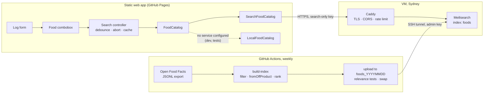

# Food search: design

Status: proposed, 2 November 2026. Milestone M1 ([#3](https://github.com/Froussios/fitbit-nutrition-portal/issues/3)).
Decision: [D3 #9](https://github.com/Froussios/fitbit-nutrition-portal/issues/9) (hosting). Work items: section 11.

This document covers typing a food name and picking a product from a dropdown of fuzzy matches. Barcode
lookup and recent foods reuse the same catalogue but have their own issues.

## 1. Requirements

Set by the owner on 2 November 2026.

| # | Requirement | How the design meets it |
|---|---|---|
| R1 | Search happens as the user types. | Debounced search on every input event, stale responses dropped (section 8.1). |
| R2 | Options appear below the field, like a dropdown. | An editable combobox with a listbox popup (section 3). |
| R3 | Fuzzy matching and ordering; show the top 10 best matches. | A search engine with typo tolerance, prefix matching and a popularity tie-break; `limit: 10` (section 4). |
| R4 | One food source for now: Open Food Facts. | The index holds Open Food Facts products only. Generic foods (AUSNUT / OpenNutrition) move to later (DR-12). |
| R5 | Rich visuals in the dropdown: a summary per food, starting with calories per unit. | Two-line rows with kcal per 100 g / 100 ml and per serving, built from a summary view model that can grow (section 3.3). |
| R6 | Arrow keys move through the options; the selected row is filled into the input. | Keyboard model in section 3.2; the typed query is kept so Escape and ArrowUp can restore it. |
| R7 | Open Food Facts is large and its APIs throttle; the hosting must support fuzzy search over the dataset. | A self-hosted search engine (Meilisearch) in Sydney, fed by a scheduled job from the Open Food Facts export (section 5). |

## 2. Scope

**In:** typed search over Open Food Facts products; the dropdown; choosing a product into the log form; a
`FoodCatalog` implementation over the search service; the index pipeline; the hosted service.

**Not in this design:**

* Barcode scanning ([#36](https://github.com/Froussios/fitbit-nutrition-portal/issues/36)). It uses `FoodCatalog.get()`, which this design provides (an exact key lookup).
* Recent foods ([#14](https://github.com/Froussios/fitbit-nutrition-portal/issues/14)). The dropdown is where they would appear when the field is empty; not built here.
* Generic foods (AUSNUT / OpenNutrition): parked as [#38](https://github.com/Froussios/fitbit-nutrition-portal/issues/38). If the coverage test ([#15](https://github.com/Froussios/fitbit-nutrition-portal/issues/15))
  misses the target, they are the first thing to add.
* Product images, Nutri-Score, macro bars. The row layout leaves room for them (section 3.3).
* kJ display preference ([#21](https://github.com/Froussios/fitbit-nutrition-portal/issues/21)). Rows show kcal for now.

## 3. User experience

### 3.1 Behaviour

The **Food** field in the log form becomes a text input with a dropdown under it.

1. The user types. From 2 characters on, the app searches after a 100 ms pause in typing (R1).
2. Up to 10 matches appear below the field, best first (R2, R3). After them comes a fixed action row,
   **Custom food "…"**, which opens the existing custom-food fields with the typed text as the name. It is
   not counted in the 10.
3. The user picks a row with the mouse, a tap, or the keyboard (section 3.2). The input shows the chosen
   food's label (`Name (Brand)`), the list closes, focus moves to **Amount**, and the units and portions
   refresh as they do now.
4. If the user edits the text after choosing, the choice is cleared and the form cannot be submitted until
   a food is chosen again. This stops an entry being logged against a food the field no longer names.

| State | Shown |
|---|---|
| Fewer than 2 characters | No list (later: recent foods, #14) |
| Searching, no previous results | List with a single "Searching…" row, only if the request takes more than 300 ms |
| Searching, previous results shown | Previous results stay; a small spinner in the field after 300 ms. No flicker between keystrokes. |
| Results | Up to 10 rows, then the custom-food row, then an attribution line |
| No results | "No match for "…"" and the custom-food row |
| Error (offline, service down, rate limited) | "Food search is unavailable right now" and the custom-food row. The next keystroke retries. |

### 3.2 Keyboard (R6)

The field follows the WAI-ARIA *editable combobox with list autocomplete* pattern. The app keeps two
values: the **typed query** (what the user typed) and the **active row** (none, or 1–10 plus the
custom-food row).

| Key | List closed | List open |
|---|---|---|
| Typing | Opens the list and searches | Clears the active row and searches the field's new text |
| ArrowDown | Opens the list (if there is a query) | Next row. The active row's label is written into the field. From the last row it returns to the field with the typed query restored. |
| ArrowUp | – | Previous row, label written into the field. From the first row it returns to the typed query. |
| Enter | Submits the form only if a food is already chosen | Chooses the active row. With no active row: does nothing (no accidental pick). |
| Tab | Normal focus move | Chooses the active row if there is one, then moves focus normally |
| Escape | Clears the field | With an active row: restores the typed query and clears the active row. Otherwise closes the list. |
| Home / End | Caret in the field | Caret in the field (rows are reached with the arrows) |

Writing a row's label into the field sets `input.value` directly. That does not fire an `input` event, so
it does not start a new search. If the user then types, the search runs on the field's text as it now
reads, so a row can be picked with the arrows and refined by typing.

Mouse hover highlights a row but does not write into the field; a click or tap chooses it.

### 3.3 Rows (R5)

```
┌──────────────────────────────────────────────────────────────┐
│ Weet-Bix Wholegrain Cereal                 358 kcal / 100 g  │
│ Sanitarium · 575 g                      107 kcal / 30 g serv │
├──────────────────────────────────────────────────────────────┤
│ Weet-Bix Blends Multi-Grain                378 kcal / 100 g  │
│ Sanitarium · 510 g                                           │
├──────────────────────────────────────────────────────────────┤
│ + Custom food "weetbix"                                      │
├──────────────────────────────────────────────────────────────┤
│ Food data: Open Food Facts (ODbL)                            │
└──────────────────────────────────────────────────────────────┘
(values illustrative)
```

* **Line 1:** product name, with the matched parts in bold. Right: kcal per 100 g or per 100 ml (the
  food's `basis`), always shown, so rows compare like for like.
* **Line 2:** brand · pack size (Open Food Facts `quantity`). Right: kcal per serving when the product has a
  serving size, e.g. `107 kcal / 30 g serving`.
* A row is built from a `FoodSummary` view model computed from the `FoodItem` by a pure function in
  `src/core/`. Later visuals (a thumbnail, a macro bar, Nutri-Score) are new fields on that model and new
  cells in the row; the search contract does not change.
* Open Food Facts text is user-contributed. It is always rendered with `textContent`, never as HTML
  (section 6.5).

### 3.4 Accessibility and mobile

* Input: `role="combobox"`, `aria-autocomplete="list"`, `aria-expanded`, `aria-controls` pointing at the
  list, `aria-activedescendant` pointing at the active row. List: `role="listbox"`; rows: `role="option"`
  with `aria-selected` on the active one. A polite live region announces "10 results" / "No results".
* Touch targets at least 44 px high; the list is the field's width and scrolls inside the viewport above
  the on-screen keyboard.
* `autocomplete="off"`, `autocapitalize="none"`, `spellcheck="false"` so the browser's own suggestions do not
  cover the list.
* No search while an IME composition is in progress (`compositionstart` / `compositionend`).

## 4. Matching and ordering (R3)

### 4.1 Query handling

* Trim and collapse whitespace. Case and diacritics are folded by the engine.
* Fewer than 2 characters: no search.
* A query of only 8, 12, 13 or 14 digits is treated as a barcode: an exact `get()` on that code, with any
  hit shown first, plus the normal text search.

### 4.2 Matching

Done by the search engine (Meilisearch defaults unless stated):

* **Prefix on the last word**, so `weet b` matches `Weet-Bix` while the user is still typing.
* **Typo tolerance**: 1 typo from 5 characters, 2 from 9 (`wheetbix`, `vegimite`).
* **Word order does not matter**, and words may match the name or the brand (`sanitarium weet`).
* **Split and joined words** (`weetbix` ↔ `weet bix`, `corn flakes` ↔ `cornflakes`).
* **Synonyms** from a small curated list kept in the repo (`coke` → `coca cola`, `choc` → `chocolate`, `maccas`
  → `mcdonald's`). It grows from misses in the relevance tests.

### 4.3 Ordering

Meilisearch ranking rules, starting order:

1. `words`: more query words matched first
2. `typo`: fewer typos first
3. `proximity`: matched words closer together first
4. `attribute`: a match in the name beats a match in the brand
5. `exactness`: whole-word matches beat prefix matches
6. `rank:desc`: a precomputed popularity score (below)

`rank` is computed by the pipeline from fields in the Open Food Facts record:

```
rank = log10(1 + unique_scans_n)       popularity in Open Food Facts apps
     + 2 if countries_tags has en:australia
     + completeness                     0..1, Open Food Facts' own score
```

Open Food Facts has many near-duplicate and incomplete entries, so the tie-break matters. The order of
rules 5 and 6 and the weights above are starting points; the relevance tests (section 10) decide.

The app asks for `limit: 10` and shows them in the engine's order.

## 5. Hosting (R7, decision D3)

### 5.1 Facts and estimates

Network access to the sources was limited when this was written; figures marked *estimate* come from search
results and must be confirmed by the first pipeline run ([#12](https://github.com/Froussios/fitbit-nutrition-portal/issues/12)).

| Fact | Value | Status |
|---|---|---|
| Open Food Facts size | About 4 million products (passed 4 M in 2025) | Estimate (Wikipedia, Open Food Facts webinar May 2025) |
| Products sold in Australia | Growing about 1,300 a month (2 % monthly) in Nov 2024, which implies about 65 k then; roughly 80–100 k now | Estimate (Open Food Facts wiki progress board) |
| Public search API limit | 10 searches per minute per IP, including Search-a-licious | Open Food Facts API docs; DR-07 |
| Export | Full JSONL dump and daily deltas on static.openfoodfacts.org; a Parquet version on Hugging Face (`food.parquet`, about 4.2 GB) | Estimate for sizes |
| Meilisearch index size | About documents × average size × 5 on disk; good performance with RAM at ⅓ of the index | Meilisearch docs (planning formula) |
| Our index | Assuming 2–3 M products survive the filters at about 500 bytes each: 5–8 GB on disk, 2–3 GB RAM | Estimate, to measure |
| Meilisearch Cloud (usage-based Build) | US$30/month including 100 k documents and 50 k searches; US$0.30 per extra 1 k documents | Meilisearch pricing page, via search |
| Typesense Cloud | Billed per hour for the cluster size you pick (RAM), plus bandwidth | Typesense help centre |
| Small VM in Sydney | 2 vCPU / 4 GB at about US$20–24 a month (Vultr; DigitalOcean similar) | Estimate (Spare Cores listing) |

Traffic: Google caps an unverified app at 100 users (V9). At about 10 foods a day and about 6 requests per
search while typing, that is roughly 6,000 requests a day, 180,000 a month. Small for any engine, but too
many for per-search pricing tiers.

### 5.2 Options

| Option | Fuzzy (R7) | Whole dataset | Latency | Cost / month | Backend? |
|---|---|---|---|---|---|
| A. Static prefix/token shards on a CDN | No: a typo in the first letters picks the wrong shard | Yes | 1 fetch | ~0 | No |
| B. SQLite FTS5 file on a CDN, queried over HTTP range requests | No: token and prefix match only, no typo tolerance or relevance ranking; several round trips per keystroke | Yes | 3–10 range requests | ~0 | No |
| C. Client-side fuzzy index (MiniSearch / Orama) of the Australian subset | Yes | **No**: a few MB for ~100 k products; 4 M is impossible in a browser | Instant after download | ~0 | No |
| D. Usage-priced search SaaS (Algolia, Meilisearch Cloud) | Yes | Yes | Low | Hundreds of US$: 3 M documents is about US$870 a month in overage on Meilisearch Cloud Build alone | Managed |
| **E. Self-hosted Meilisearch (or Typesense) on a small VM in Sydney** | **Yes** | **Yes** | **Low, same city** | **About US$20–25** | **Yes, stateless** |
| F. Typesense Cloud (resource-priced, managed) | Yes | Yes | Low (choose an Australian region) | Price for 4 GB RAM to confirm | Managed |
| G. Open Food Facts' own search API | Yes | Yes | – | – | Excluded by its rate limit (DR-07) |

### 5.3 Recommendation

**Option E with Meilisearch.** It is the only option that meets R7 at a hobby-project cost. Options A and B
cannot do fuzzy search, C cannot hold the dataset, D is priced for the wrong shape of traffic, and G is
throttled.

* **Meilisearch over Typesense:** its index lives on disk and is memory-mapped, so a 4 GB VM copes as the
  index grows (slower, not crashing). Typesense keeps the whole index in RAM. Both have typo tolerance,
  prefix search, custom ranking, search-only API keys and CORS. The app talks to the engine through one
  `FoodCatalog` adapter, so swapping engines touches one file and the pipeline's upload step.
* **Option F is the fallback** if running a VM turns out to be a chore: same idea, managed, priced by size
  rather than by search.
* **Option C stays useful later** as the offline cache for M2 ([#20](https://github.com/Froussios/fitbit-nutrition-portal/issues/20)): recent and Australian foods
  searched in the browser when the service cannot be reached.

**DR-01 exception.** This is a running server. DR-01 allows one if it is recorded and holds no user data at
rest. The service holds only public Open Food Facts data, can be rebuilt from the export at any time (so it
needs no backups), and never sees who is searching. Search terms are mildly sensitive (they reveal what
someone eats), so queries are sent in POST bodies and the proxy does not log bodies (section 6.6).

## 6. Architecture



### 6.1 Index documents

Each document is an Open Food Facts product record cut down to the fields `OffProduct` reads, so
`fromOffProduct()` stays the single normaliser (constraint from #3). Two fields are added for search:

```json
{
  "code": "9300652000000",
  "product_name": "Weet-Bix Wholegrain Cereal",
  "brands": "Sanitarium",
  "quantity": "575 g",
  "product_quantity": 575,
  "product_quantity_unit": "g",
  "serving_size": "2 biscuits (30 g)",
  "serving_quantity": 30,
  "serving_quantity_unit": "g",
  "nutrition_data_per": "100g",
  "nutriments": { "energy-kcal_100g": 358, "proteins_100g": 12, "...": "only the keys in NUTRIENTS" },
  "rank": 4.1,
  "au": true
}
```
(values illustrative)

Primary key `code`. Expected size about 400–600 bytes per document.

### 6.2 Index settings (starting point)

```json
{
  "searchableAttributes": ["product_name", "brands"],
  "displayedAttributes": ["code", "product_name", "brands", "quantity", "product_quantity",
    "product_quantity_unit", "serving_size", "serving_quantity", "serving_quantity_unit",
    "nutrition_data_per", "nutriments"],
  "rankingRules": ["words", "typo", "proximity", "attribute", "exactness", "rank:desc"],
  "filterableAttributes": ["au"],
  "synonyms": "from pipeline/synonyms.json",
  "pagination": { "maxTotalHits": 100 }
}
```

`au` is filterable so an "Australian products only" switch can be added without reindexing.

### 6.3 Client contract

`FoodCatalog` gains an abort signal, a result limit, and match ranges for highlighting:

```ts
export interface TextRun { readonly text: string; readonly match: boolean }

export interface FoodSearchHit {
  readonly food: FoodItem;
  /** Name and brand split into matched and unmatched runs, for bold highlights. */
  readonly name: readonly TextRun[];
  readonly brand?: readonly TextRun[];
}

export interface FoodCatalog {
  /** Best matches first. `limit` defaults to 10. */
  search(query: string, options?: { limit?: number; signal?: AbortSignal }): Promise<FoodSearchHit[]>;
  /** Exact lookup, e.g. by barcode. */
  get(ref: FoodRef, options?: { signal?: AbortSignal }): Promise<FoodItem | undefined>;
}
```

* `SearchFoodCatalog` (new, `src/food/search-catalog.ts`) calls the service with `fetch`; no SDK, to keep
  the bundle small. Hits go through `fromOffProduct()`; a hit that fails to normalise is dropped and logged.
* `LocalFoodCatalog` keeps working for development and tests, with a simple fuzzy scorer so the UI behaves
  the same without the service. Relevance is only tested against the real engine.
* `main.ts` stops loading the whole catalogue up front (`catalog.search("")`); the log form receives the
  catalogue instead of an array of foods.

Search request:

```http
POST https://<search host>/indexes/foods/search
Authorization: Bearer <public search-only key>
Content-Type: application/json

{
  "q": "weetbix",
  "limit": 10,
  "attributesToHighlight": ["product_name", "brands"],
  "highlightPreTag": "",
  "highlightPostTag": ""
}
```

The highlight tags are private-use characters, not HTML. The client splits `_formatted.product_name` on
them into `TextRun`s and renders each run as a text node.

Barcode lookup: `GET /indexes/foods/documents/<code>` with the same key.

### 6.4 Configuration

| Variable | Meaning |
|---|---|
| `VITE_FOOD_SEARCH_URL` | Base URL of the search service, e.g. `https://search.example.org` |
| `VITE_FOOD_SEARCH_KEY` | Public Meilisearch key with only the `search` and `documents.get` actions on index `foods` |

Both are public and baked in at build time, like the OAuth client ID. Without them the app uses
`LocalFoodCatalog`.

### 6.5 Security

* The browser holds only the search-only key; it cannot change the index. The admin key lives in GitHub
  Actions secrets.
* Meilisearch listens on localhost only. Caddy exposes just `POST /indexes/foods/search` and
  `GET /indexes/foods/documents/*`; everything else is refused. The pipeline reaches the admin API through
  an SSH tunnel.
* CORS allows the GitHub Pages origin and `http://localhost:5173`.
* A per-IP rate limit at the proxy, generous enough for fast typing (for example 20 requests a second, burst
  40).
* Open Food Facts text is untrusted: rendered with `textContent` only (the existing `el()` helper already
  does this).

### 6.6 Privacy

The service never receives Google tokens or user identifiers. Search terms are in POST bodies, which Caddy
does not log; access logs are kept off or reduced to status and timing.

## 7. Index pipeline

A Node script in the repo (`pipeline/`), run by a scheduled GitHub Action (weekly, plus manual runs).

1. **Download** the Open Food Facts JSONL export, streamed and decompressed on the fly (never stored
   uncompressed). JSONL keeps the record shape the app already reads; the Parquet export is the fallback if
   the runner is too slow.
2. **Filter** each product: needs a name (`product_name`, falling back to `product_name_en`), must pass
   `fromOffProduct()` (usable energy), and energy must be plausible (0–900 kcal per 100 g/ml). The
   normaliser is imported from `src/core/off.ts`, so build time and run time agree.
3. **Shape** each survivor into the document in section 6.1 and compute `rank` and `au`.
4. **Report** counts (read, kept, dropped by reason), document size and estimated index size, as a job summary.
5. **Upload** into a new index `foods_<date>`: apply settings first (Meilisearch uses less memory that way),
   then add documents in NDJSON batches and wait for indexing.
6. **Gate** on the relevance tests (section 10) against the new index. On failure stop; the live index is
   untouched.
7. **Swap** `foods_<date>` with `foods` (atomic) and delete the index from two runs ago, so one previous
   index remains for rollback.

Daily delta updates can come later; weekly full rebuilds keep the pipeline simple and self-healing.

**Licence.** The Open Food Facts database is under ODbL; our index is a derivative database. The app shows
"Food data: Open Food Facts (ODbL)" with a link in the dropdown and the footer. To meet share-alike, the
pipeline is public in this repo, and each run publishes its filtered output (or, if too large, the export
date it was built from) alongside a release. Confirm the approach when building #12.

## 8. Client implementation

### 8.1 Search controller

A small class between the combobox and `FoodCatalog`, unit-tested with fake timers and a fake catalogue:

* **Debounce** 100 ms after the last keystroke.
* **Cancel** the previous request with `AbortController` when a new one starts.
* **Drop stale responses**: a response is used only if its query still equals the current query, even if
  the abort came too late.
* **Cache** the last 50 queries (LRU), so Backspace and repeated searches are instant.
* **Errors**: surface a single error state; never throw into the UI; retry on the next keystroke.

### 8.2 Combobox

* `src/ui/food-combobox.ts`: DOM, events and ARIA.
* `src/ui/combobox-state.ts`: the keyboard model in section 3.2 as a pure reducer
  (`state, event → state`), so every row in that table becomes a unit test without a DOM.
* `src/core/food-summary.ts`: `FoodItem → FoodSummary` (kcal per 100, basis, per-serving kcal and label).

## 9. Performance budgets

| Measure | Target |
|---|---|
| Last keystroke → rows on screen, Australian broadband, p95 | ≤ 250 ms (100 ms debounce + network + render) |
| Engine processing time per search, p95 | ≤ 50 ms |
| Response size for 10 hits | ≤ 15 KB |
| Added JavaScript for the combobox and catalogue | ≤ 10 KB gzipped |

## 10. Testing

* **Unit (Vitest):** keyboard reducer (every row of section 3.2); search controller (debounce, abort,
  stale responses, cache, errors); highlight splitting; `FoodSummary`; the pipeline's filter and `rank`.
* **Relevance suite** (`pipeline/relevance.json`): queries with the product expected in the top N, for
  example `weetbix`, `wheetbix`, `vegemite`, `coke zero`, `big mac`, `tim tam`, `sanitarium weet`. It runs
  against every new index before the swap (section 7, step 6) and is the tool for tuning ranking and
  synonyms. The coverage test list ([#15](https://github.com/Froussios/fitbit-nutrition-portal/issues/15)) is folded into it.
* **Manual:** keyboard-only and screen-reader pass (VoiceOver on iOS, TalkBack on Android), phone and
  desktop.

## 11. Work items

| Order | Issue | What |
|---|---|---|
| 1 | [#9](https://github.com/Froussios/fitbit-nutrition-portal/issues/9) Decision D3 | Confirm option E (Meilisearch on a Sydney VM) and record it as a DR-01 exception |
| 2 | [#37](https://github.com/Froussios/fitbit-nutrition-portal/issues/37) Host the food search service | VM, Docker Compose (Meilisearch + Caddy), TLS, keys, CORS, rate limit, provisioning notes in `infra/search/` |
| 3 | [#12](https://github.com/Froussios/fitbit-nutrition-portal/issues/12) Index pipeline | Section 7, plus `SearchFoodCatalog` |
| 3 | [#15](https://github.com/Froussios/fitbit-nutrition-portal/issues/15) Coverage spike | Can start as soon as the pipeline runs locally against a Meilisearch container |
| 4 | [#13](https://github.com/Froussios/fitbit-nutrition-portal/issues/13) Search-as-you-type UI | Sections 3, 8 |
| 5 | [#36](https://github.com/Froussios/fitbit-nutrition-portal/issues/36) Barcode lookup | Camera and manual entry, via `get()` |
| 6 | [#14](https://github.com/Froussios/fitbit-nutrition-portal/issues/14) Recent foods | Unchanged; shows in the empty dropdown |

## 12. Open questions

* **Index size after filtering.** Decides whether 4 GB of RAM is enough. Measured by the first pipeline run.
* **Provider and domain.** Vultr or DigitalOcean in Sydney; the service needs a domain (or subdomain) for TLS.
* **Barcode forms.** Open Food Facts stores some products as UPC-A (12 digits) and some as EAN-13 with a
  leading 0. The pipeline may need to index both forms.
* **Per-serving kcal.** Open Food Facts serving sizes are sometimes wrong. If the coverage test finds many,
  show per-serving values only when they agree with the per-100 values.
* **Australian-only switch.** The `au` filter exists; whether the UI offers it waits for real use.
